# Aprendizado de máquina: árvores e ensembles, agrupamento espectral, aprendizado por reforço e redes convolucionais

## Introdução

**Objetivo.** Este relatório documenta o módulo 9.4 (Aprendizado de Máquina) do portfólio. Para cada uma das quatro famílias pedidas no plano de ensino foi escolhido um problema com dados públicos ou um simulador próprio. Os algoritmos centrais foram **escritos à mão**, e os resultados foram medidos com experimentos reproduzíveis, comparações pareadas, validação aninhada e ablações. Bibliotecas prontas (scikit-learn, SciPy, PyTorch) aparecem só como fonte de dados, partições e **verdade de referência** nos `assert`. No projeto 4 o PyTorch fornece tensores, autograd e camadas; a convolução da LeNet, a perda, o otimizador e o laço de treino são próprios.

**Os projetos.**

| #   | Família | Problema | Script |
| --- | --- | --- | --- |
| 1 | Supervisionado não neural | Diagnóstico de tumor de mama (Breast Cancer Wisconsin) e robustez a rótulos errados: CART, Random Forest, Rotation Forest, boosting com validação aninhada, calibração de Platt, stacking e decisão com custo | [`01_supervisionado_arvores.py`](https://github.com/fsousac/portifolio-IA/blob/main/aprendizado-maquina-ia/01_supervisionado_arvores.py) |
| 2 | Não supervisionado | Descobrir os dígitos manuscritos (UCI Digits) sem rótulos: PCA, k-means/k-means++, GMM por EM, DBSCAN, agrupamento espectral e propagação de rótulos com poucos exemplos | [`02_nao_supervisionado_digitos.py`](https://github.com/fsousac/portifolio-IA/blob/main/aprendizado-maquina-ia/02_nao_supervisionado_digitos.py) |
| 3 | Aprendizado por reforço | Padaria que aprende quanto encomendar com demanda semanal: Q-learning, SARSA, Expected SARSA, Dyna-Q e R-MAX contra a política ótima exata | [`03_reforco_estoque.py`](https://github.com/fsousac/portifolio-IA/blob/main/aprendizado-maquina-ia/03_reforco_estoque.py) |
| 4 | Deep Learning | Fashion-MNIST: softmax, MLP, LeNet-5 com convolução própria e CNN com BatchNorm, dropout, aumento de dados e suavização de rótulos, com ablação em regime de sobreajuste | [`04_deep_learning_cnn.py`](https://github.com/fsousac/portifolio-IA/blob/main/aprendizado-maquina-ia/04_deep_learning_cnn.py) |

**Como reproduzir.** Requer Python 3 e `pip install -r requirements.txt` (numpy, matplotlib, scikit-learn, torch, torchvision). Cada script é independente, usa sementes fixas, imprime as tabelas e grava as figuras em `figs/`; a saída completa fica em `figs/NN_saida.txt`. Os projetos 1 a 3 não usam internet. O 4 baixa o Fashion-MNIST uma vez para `dados/` (não versionado) e guarda os pesos treinados em `dados/cache04/`, para que uma segunda execução refaça tabelas e figuras sem treinar de novo. Métricas e contagens se repetem entre execuções; só os tempos variam. Os experimentos caros rodam em 4 processos paralelos, o que não muda nenhum número, porque cada tarefa tem a própria semente. Passo a passo no [README principal](https://github.com/fsousac/portifolio-IA/blob/main/README.md) e no [README do módulo](https://github.com/fsousac/portifolio-IA/blob/main/aprendizado-maquina-ia/README.md).

**Critério de escolha dos problemas.** Cada problema tem três propriedades:

1. Uma verdade verificável de forma independente: implementação do scikit-learn ou do PyTorch, propriedade matemática ou MDP resolvido exatamente.
2. Uma dificuldade ajustável: ruído de rótulo, dimensão, número de rótulos, dias de experiência, tamanho do treino.
3. Um resultado visual ou interpretável.

Evitou-se o exemplo mínimo de livro:

- O projeto 1 vai além da acurácia, com calibração, custo assimétrico e ruído de rótulo.
- O 2 transforma agrupamento em classificador com 10 a 50 rótulos.
- O 3 compara os aprendizes com o ótimo exato e com a política clássica (s,S) da pesquisa operacional.
- O 4 usa o Fashion-MNIST no lugar do MNIST e mede cada componente da CNN num regime em que a regularização faz diferença.

Conceitos além do visto em aula, por projeto:

| Projeto | Conceitos |
| --- | --- |
| 1 | Rotation Forest, boosting estocástico com passo de Newton, validação cruzada aninhada, calibração de Platt pelo OOB, stacking, ECE e limiar de Bayes |
| 2 | k-means++, BIC, DBSCAN, Laplaciano de grafo, agrupamento espectral e propagação de rótulos (semi-supervisionado) |
| 3 | Expected SARSA, Dyna-Q, R-MAX (exploração otimista com modelo), avaliação exata de políticas e estrutura (s,S) |
| 4 | im2col, BatchNorm, Nesterov, escalonamento cosseno, suavização de rótulos, TTA e verificação por diferenças finitas |

## Índice

1. Projeto 1 - Supervisionado não neural: árvores, florestas e boosting
2. Projeto 2 - Não supervisionado: descobrindo dígitos sem rótulos
3. Projeto 3 - Aprendizado por reforço: reposição de estoque
4. Projeto 4 - Deep Learning: CNN no Fashion-MNIST
5. Conclusão geral

---

## Projeto 1 - Supervisionado não neural: árvores, florestas e boosting

**Código:** [`01_supervisionado_arvores.py`](https://github.com/fsousac/portifolio-IA/blob/main/aprendizado-maquina-ia/01_supervisionado_arvores.py) · **Como rodar:** [README do módulo](https://github.com/fsousac/portifolio-IA/blob/main/aprendizado-maquina-ia/README.md)

### 1. Problema

O *Breast Cancer Wisconsin (Diagnostic)* (UCI, distribuído com o scikit-learn) tem **569 exames** de punção de mama. Cada exame traz **30 atributos numéricos** do núcleo celular (raio, textura, concavidade etc., em média, erro padrão e "pior" valor) e o diagnóstico: **212 malignos** e 357 benignos. A classe positiva é **maligno**. O classificador deve acertar, dar **probabilidades confiáveis** e permitir decidir quando **deixar passar um câncer (falso negativo) custa 10 vezes mais** que pedir um exame extra (falso positivo).

Um segundo experimento usa dados **sintéticos** (`make_classification`: 1000 exemplos, 20 atributos, 6 informativos) com dificuldade ajustável: **0% a 30% dos rótulos de treino trocados**. A avaliação usa o rótulo verdadeiro, o que mede quanto cada método "decora" o ruído.

**Protocolo e métricas.** Validação cruzada estratificada de 5 dobras repetida com 5 sementes, ou seja, **25 dobras pareadas**: todos os métodos veem as mesmas partições. Medem-se acurácia, AUC, log-loss (qualidade das probabilidades), **ECE** (erro de calibração: diferença média entre probabilidade prevista e frequência observada, em 10 faixas) e custo médio por exame. Todo hiperparâmetro é escolhido **dentro** da dobra de treino (validação aninhada).

### 2. Algoritmos

Tudo em numpy, com a mesma rotina de árvore em todos os métodos. Para y ∈ {0,1}, a soma dos quadrados dos resíduos de um nó vale n·p(1−p), que é n/2 vezes o índice de **Gini**. Por isso a árvore de classificação e a de regressão do boosting são o mesmo código.

| Algoritmo | Descrição |
| --- | --- |
| CART | Corte x_j ≤ t por busca exaustiva vetorizada (ordenação + somas acumuladas) |
| Random Forest / Bagging | 100 árvores profundas em amostras bootstrap, com √p = 5 atributos sorteados por nó (o Bagging usa todos), e erro **out-of-bag** |
| **Rotation Forest** (Rodríguez et al., 2006) | Para cada árvore, os atributos padronizados são divididos em 10 grupos aleatórios de 3. Roda-se PCA em cada grupo com 75% de uma amostra (de um subconjunto de classes) e monta-se uma rotação ortogonal bloco-diagonal R. A árvore CART completa é treinada em XR, de modo que os cortes ficam **oblíquos** no espaço original |
| Gradient Boosting | Perda logística: cada árvore ajusta o pseudo-resíduo y − p, e a folha recebe o passo de Newton Σr / Σp(1−p), multiplicado pela taxa ν |
| **Boosting estocástico com CV aninhada** | Subamostra de 70% por árvore e ν = 0,05. A profundidade ∈ {1, 2, 3} e o número de árvores (até 400) são escolhidos pela log-loss de uma CV **interna** de 3 dobras, usando só o treino da dobra externa. A curva por estágio sai de uma única passada |
| **RF + Platt** | Calibração P = σ(a·s + b) ajustada nas probabilidades **out-of-bag** da própria floresta, sem gastar dados de calibração |
| **Stacking** (Wolpert, 1992) | Uma CV interna de 5 dobras gera probabilidades fora-da-dobra de 4 bases (logística, RF, Rotation Forest, boosting ν = 0,1). Uma logística L2 sobre os logits dessas probabilidades aprende a combiná-las |
| Regressão logística | L2 (C = 1) por Newton (IRLS), com atributos padronizados no treino |

```
boosting_aninhado(X, y):                      # so dados de treino da dobra externa
  para prof em {1,2,3}, para cada dobra interna (tr, va):
     ajusta 400 arvores (nu = 0.05, subamostra 70%) em tr
     perda[prof][m] += log-loss em va apos m arvores, m = 1..400
  (prof*, m*) = argmin perda;  reajusta com (prof*, m*) em X inteiro
```

**Decisão com custo.** Se p = P(maligno | x) for calibrada, o limiar que minimiza o custo esperado é C_FP / (C_FP + C_FN) = **1/11 ≈ 0,091** (limiar de Bayes). Fixado antes de ver os dados, ele dá uma estimativa honesta do custo; o "melhor limiar a posteriori" também é reportado, mas é otimista.

**Verdade de referência.** A árvore própria tem a mesma acurácia de treino que o `DecisionTreeClassifier` em todas as profundidades e concorda em ≥ 99,3% das predições de teste; a de regressão coincide com o `DecisionTreeRegressor` (7·10⁻¹⁷). A logística coincide com a `LogisticRegression` (1,5·10⁻⁶), Platt com a logística 1-D do scikit-learn (1,9·10⁻¹⁰), a AUC com o `roc_auc_score` (inclusive com empates), e cada rotação do Rotation Forest é ortogonal (‖RᵀR − I‖ = 8,9·10⁻¹⁶).

### 3. Resultados

**Comparação pareada (25 dobras, média ± IC 95%).**

| método | acurácia | AUC | log-loss | ECE |
| --- | --- | --- | --- | --- |
| Logística L2 | **0,9807 ± 0,0048** | **0,9956 ± 0,0021** | **0,0728 ± 0,0130** | 0,0182 |
| CART prof = 3 | 0,9290 ± 0,0096 | 0,9372 ± 0,0138 | 0,6319 ± 0,1484 | 0,0459 |
| CART profunda | 0,9248 ± 0,0065 | 0,9223 ± 0,0080 | 2,0785 ± 0,1809 | 0,0752 |
| Bagging | 0,9533 ± 0,0077 | 0,9882 ± 0,0035 | 0,1811 ± 0,0450 | 0,0237 |
| Random Forest | 0,9585 ± 0,0084 | 0,9905 ± 0,0034 | 0,1483 ± 0,0362 | 0,0295 |
| RF + Platt (OOB) | 0,9603 ± 0,0081 | 0,9905 ± 0,0034 | 0,1091 ± 0,0177 | 0,0173 |
| **Rotation Forest** | **0,9712 ± 0,0058** | 0,9924 ± 0,0032 | 0,1353 ± 0,0410 | 0,0261 |
| Boosting ν = 1,0 | 0,9652 ± 0,0059 | 0,9921 ± 0,0031 | 0,2183 ± 0,0536 | 0,0307 |
| Boosting ν = 0,1 | 0,9610 ± 0,0080 | 0,9928 ± 0,0023 | 0,1037 ± 0,0172 | 0,0206 |
| Boosting estoc. + CV aninhada | 0,9666 ± 0,0044 | 0,9923 ± 0,0025 | 0,0967 ± 0,0123 | **0,0164** |
| **Stacking (4 bases)** | **0,9786 ± 0,0050** | 0,9951 ± 0,0021 | 0,0772 ± 0,0148 | 0,0170 |

**Diferenças pareadas (IC 95% nas 25 dobras).**

| comparação | diferença | dobras em que o primeiro vence |
| --- | --- | --- |
| Acurácia, Rotation Forest − RF | **+0,0126 ± 0,0056** | 17/25 |
| Acurácia, Stacking − RF | **+0,0200 ± 0,0074** | 21/25 |
| Log-loss, Stacking − RF | −0,0712 ± 0,0338 | 24/25 |
| Acurácia, Stacking − Logística | −0,0021 ± 0,0038 (empate) | - |
| AUC, RF − CART profunda | +0,0682 ± 0,0065 | 25/25 |
| Log-loss, ν = 0,1 − ν = 1 | −0,1145 ± 0,0427 | - |

Leitura dos resultados:

- **A árvore isolada é o pior modelo**: 92,5% de acurácia e log-loss 2,08, porque folhas puras dizem "100%" e erram. Ensembles corrigem isso em todas as dobras.
- O **Rotation Forest** é a melhor floresta (97,1%, 1,3 ponto acima da RF). Ele corrige a principal fraqueza das árvores neste conjunto: os atributos de tamanho (raio, área, perímetro) são muito correlacionados e a fronteira é inclinada. Cortes paralelos aos eixos precisam de uma "escada" para aproximá-la; cortes rodados a seguem com poucos nós.
- O **stacking** chega a 97,9%, empatado com a logística (diferença −0,0021 ± 0,0038). Ele aprende a dar peso a ela e combina a flexibilidade das árvores sem perder a calibração.
- Mesmo assim, a **regressão logística continua a melhor isolada**: com 569 exemplos e classes quase separáveis por um hiperplano, nenhum método de árvores a supera. Este é um resultado honesto do conjunto, não um defeito das implementações, como o experimento sintético abaixo confirma.
- A **validação aninhada** escolheu árvores de profundidade 1 (*stumps*) em 18 das 25 dobras e profundidade 3 em 7, com 292 árvores em média (de 104 a 400). Um modelo aditivo de efeitos individuais basta, o que é coerente com a vitória do modelo linear.

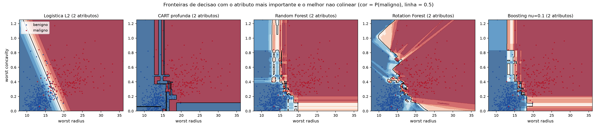

**Calibração.** Platt reduz a log-loss da RF de 0,148 para 0,109 e o ECE de 0,030 para 0,017, sem mudar a AUC (a transformação é monótona). O boosting com ν = 1 tem a pior calibração entre os ensembles (ECE 0,031): o passo de Newton inteiro empurra as probabilidades para 0 e 1. No diagrama de confiabilidade ele fica muito acima da diagonal entre 0,1 e 0,2: subestima o risco de casos duvidosos.

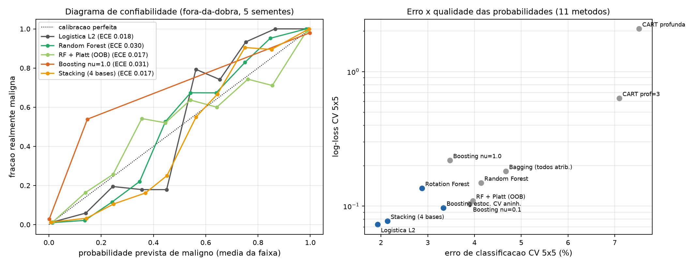

**OOB e curvas.** Numa partição 75/25, a floresta de 300 árvores tem erro **OOB 0,0493** contra erro de teste 0,0490: o OOB estima a generalização sem gastar dados. No boosting, a perda de teste tem um mínimo e depois sobe: 0,1536 na iteração 8 com ν = 1 e 0,1187 na iteração 131 com ν = 0,1. Com ν = 1, o passo de Newton inteiro chega a aumentar a perda de treino uma vez. É esse ponto de parada que a CV aninhada encontra automaticamente.

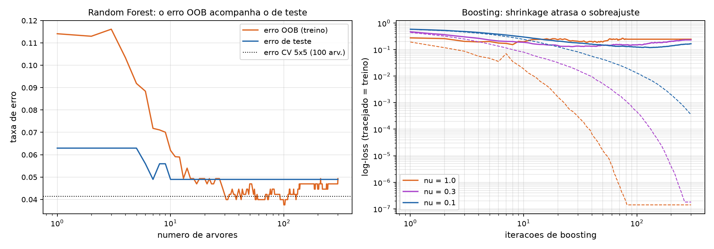

**Ruído de rótulo (sintético, 5 dobras × 2 sementes, acurácia no rótulo verdadeiro).**

| ruído | Logística | CART profunda | Random Forest | Rotation Forest | Boosting ν = 0,1 | Boosting + CV aninhada |
| --- | --- | --- | --- | --- | --- | --- |
| 0% | 0,7885 | 0,8370 | 0,9150 | **0,9290** | 0,8955 | 0,9135 |
| 10% | 0,7770 | 0,7645 | 0,8955 | **0,9100** | 0,8535 | 0,8795 |
| 20% | 0,7680 | 0,6930 | 0,8660 | **0,8680** | 0,8100 | 0,8440 |
| 30% | 0,7540 | 0,6205 | 0,7765 | **0,7790** | 0,7250 | **0,7790** |

Aqui a fronteira é não linear, e os ensembles de árvores vencem a logística por 14 pontos sem ruído. Com 30% de rótulos trocados, a **árvore profunda perde 21,6 pontos** (decora cada rótulo errado) e o boosting de 150 iterações fixas perde 17,1 (persegue os resíduos errados). O **boosting com CV aninhada perde só 13,5** e supera o de iterações fixas em todos os níveis, porque a CV interna detecta o sobreajuste e escolhe menos árvores ou árvores mais rasas. O Rotation Forest é o melhor ou empata em todos os níveis.

**Decisão com custo FN = 10 × FP (probabilidades fora da dobra, média de 5 sementes).**

| método | custo, limiar 0,5 | custo, limiar 1/11 (honesto) | FN em 1/11 | melhor limiar a posteriori (custo) |
| --- | --- | --- | --- | --- |
| Logística L2 | 0,1459 | **0,1206** | 3,2 | 0,21 (0,1107) |
| Random Forest | 0,2619 | 0,1670 | 3,0 | 0,21 (0,1276) |
| RF + Platt (OOB) | 0,2517 | 0,1290 | 4,4 | 0,08 (0,1251) |
| Rotation Forest | 0,1782 | 0,1434 | 2,6 | 0,31 (0,1033) |
| Boosting + CV aninhada | 0,2295 | 0,1290 | 4,2 | 0,10 (0,1269) |
| Stacking | 0,1322 | 0,1286 | 4,0 | 0,23 (0,1083) |

O limiar de Bayes reduz o custo de **todos** os métodos sem treinar de novo (−17% na logística, −36% na RF). A calibração é o que torna o limiar teórico confiável: na RF crua o melhor limiar empírico (0,21) está longe de 1/11 e o custo em 1/11 é 0,167; depois de Platt o melhor limiar vira 0,08, praticamente 1/11, e o custo honesto cai para 0,129. Nos modelos calibrados (logística, Platt, boosting aninhado, stacking), o custo em 1/11 fica a menos de 0,021 do ótimo a posteriori. Na RF + Platt (semente 0), os falsos negativos caem de 11 para 4 em 212 malignos, ao preço de 28 falsos positivos em vez de 9.

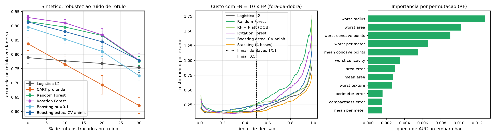

A importância por permutação destaca atributos de **tamanho** (pior raio, 0,0128; pior área, 0,0102) e de **forma** (pior número de pontos côncavos, 0,0091). Atributos correlacionados dividem a importância entre si.

### 4. Considerações finais

**Potenciais.** Ensembles corrigem a variância da árvore (+0,07 de AUC em 25/25 dobras). O Rotation Forest mostra que **mudar a geometria dos cortes** vale mais que adicionar árvores (+1,3 ponto sobre a RF). A validação aninhada torna o boosting robusto ao ruído sem ajuste manual, e a calibração pelo OOB é gratuita e faz o limiar de Bayes funcionar. Num problema médico, **o limiar importa tanto quanto o modelo**, e a calibração permite escolhê-lo pela teoria, sem olhar os dados de teste.

**Limitações.** No conjunto real a logística continua imbatível: o stacking só a iguala, e as vantagens das árvores aparecem no sintético, cujo processo gerador (hipercubos gaussianos) as favorece. 569 exames dão intervalos largos, e várias diferenças entre ensembles (Platt × RF em acurácia, boosting aninhado × ν = 0,1) não são significativas. O ruído sintético usa só 10 dobras por nível, o custo 10:1 é uma suposição, não um valor clínico, e as árvores em Python puro são lentas: o Rotation Forest e o stacking dominam os ~11 min do script, mesmo em 4 processos. **O que mudaria:** calibração isotônica, um conjunto tabular maior e não linear (em que as árvores tenham vantagem real) e testes estatísticos corrigidos para validação cruzada repetida (Nadeau-Bengio).

---

## Projeto 2 - Não supervisionado: descobrindo dígitos sem rótulos

**Código:** [`02_nao_supervisionado_digitos.py`](https://github.com/fsousac/portifolio-IA/blob/main/aprendizado-maquina-ia/02_nao_supervisionado_digitos.py) · **Como rodar:** [README do módulo](https://github.com/fsousac/portifolio-IA/blob/main/aprendizado-maquina-ia/README.md)

### 1. Problema

O *Optical Recognition of Handwritten Digits* (UCI, no scikit-learn) tem **1797 imagens 8×8** (64 pixels de 0 a 16) de dígitos 0-9 escritos por 43 pessoas. Os algoritmos recebem **só as imagens**. As perguntas são:

1. Os grupos encontrados coincidem com os dígitos?
2. Quantos grupos os dados "pedem"?
3. Reduzir a dimensão ajuda?
4. Qual noção de grupo funciona melhor: distância ao centro, densidade ou conectividade num grafo?
5. Se um humano rotular **m = 10 a 50 imagens**, que acurácia se obtém nas 1797?

**Métricas.** Sem rótulos: inércia, silhueta e BIC. Com rótulos (só para avaliar): ARI (índice de Rand ajustado ao acaso, em que 0 = acaso e 1 = idêntico) e acurácia após o casamento ótimo grupo → dígito pelo algoritmo húngaro.

### 2. Algoritmos

| Algoritmo | Descrição |
| --- | --- |
| PCA | SVD da matriz centrada |
| k-means / k-means++ | Lloyd; o k-means++ sorteia cada novo centro com probabilidade ∝ D(x)² |
| GMM por EM | Covariância completa ou diagonal, passo E em log-espaço, regularização reg·I, BIC; também "melhor de 10 inícios" pela log-verossimilhança, critério que não usa rótulos |
| DBSCAN | Pontos-núcleo e expansão por busca em largura |
| **Agrupamento espectral** (Ng, Jordan e Weiss, 2002) | Grafo dos 10 vizinhos mais próximos A = (C + Cᵀ)/2, Laplaciano normalizado L = I − D^(−1/2) A D^(−1/2), os k menores autovetores (`eigh`), linhas normalizadas e k-means++. O maior salto entre autovalores (*eigengap*) sugere k |
| **Propagação de rótulos** (Zhou et al., 2004) | Com S = D^(−1/2) A D^(−1/2), F = (1 − α)(I − αS)⁻¹ Y com α = 0,99: o rótulo de cada imagem rotulada se difunde pelo grafo e cada imagem recebe a classe com mais "calor" |

```
espectral(X, k):
  A = grafo dos 10 vizinhos (simetrico);  L = I - D^-1/2 A D^-1/2
  U = k autovetores de menor autovalor de L;  normaliza cada linha de U
  devolve k-means++(linhas de U, k)
```

A intuição do espectral: o k-means mede distância a um centro e só acha grupos "redondos". O grafo de vizinhos segue a **variedade** em que cada dígito vive: um "1" inclinado está ligado a um "1" reto por uma cadeia de vizinhos, mesmo longe dele em linha reta.

**Verdade de referência.**

- PCA = `sklearn.PCA` (1,4·10⁻¹⁶).
- A inércia do k-means nunca cresce, e o melhor de 10 inícios (4552,59) fica a 0,02% do `KMeans`.
- A log-verossimilhança do EM é monótona e igual ao `GaussianMixture.score` com os mesmos parâmetros.
- O DBSCAN tem os mesmos núcleos e a mesma partição que o `sklearn.DBSCAN`.
- **Laplaciano:**
  - é simétrico, com espectro em [0, 2];
  - a multiplicidade do autovalor 0 é igual ao número de componentes conexas (8 no grafo 2-NN, 2 no 3-NN, 1 no 10-NN), contadas por busca em largura própria e conferidas com o SciPy;
  - Lu = λu para os autovetores.
- A propagação em forma fechada é igual à iteração de ponto fixo F ← αSF + (1 − α)Y (diferença de 8·10⁻¹²).
- O espectral próprio tem ARI 0,822; o `SpectralClustering` do scikit-learn, com o mesmo grafo, tem 0,757; a concordância entre os dois é 0,872 (diferem na inicialização do k-means final).

### 3. Resultados

O PCA concentra 28,5% da variância em 2 componentes, 73,8% em 10 e 89,4% em 20.

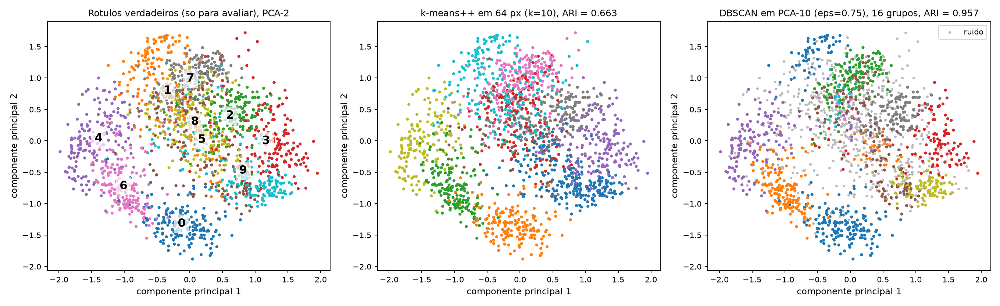

**Comparação dos agrupamentos (ARI com os dígitos, k = 10).**

| método | ARI |
| --- | --- |
| k-means++ em 64 px (10 sementes) | 0,648 ± 0,029 |
| k-means++ em PCA-20 | 0,664 ± 0,009 |
| GMM diagonal em PCA-20 | 0,683 ± 0,051 |
| GMM completa em PCA-20 (5 sementes) | 0,773 ± 0,065 |
| GMM completa, melhor de 10 inícios por log-verossimilhança | 0,792 ± 0,051 |
| **Espectral, grafo 10-NN** (5 sementes) | **0,823 ± 0,001** |
| DBSCAN ε = 0,75 (só nos 67,7% não marcados como ruído) | 0,957 |

O **espectral** é o melhor método que agrupa todas as imagens. Supera o k-means em **5/5 sementes** (+0,166 de ARI), chega a **88,9% de acurácia casada** (contra 78,4% do k-means) e é quase determinístico (desvio 0,001). A GMM completa precisa de PCA e de vários inícios e ainda varia muito entre sementes. O ARI de 0,957 do DBSCAN não é comparável: ele recusa 32,3% das imagens como ruído, e com ε = 0,85 o ruído cai a 13,2%, mas grupos se fundem e o ARI despenca para 0,359.

**Sensibilidade do espectral ao número de vizinhos.**

| vizinhos | ARI | eigengap sugere k |
| --- | --- | --- |
| 5 | 0,778 | 21 |
| 10 | **0,823** | 11 |
| 15 | 0,753 | 11 |
| 20 | 0,787 ± 0,034 | 18 |

Com poucos vizinhos o grafo quase se parte em componentes. Com muitos, ligações entre dígitos diferentes borram a fronteira. O eigengap do grafo 10-NN aponta **k = 11**, muito perto dos 10 dígitos e sem usar rótulos. Os critérios clássicos discordam mais (tabela abaixo).

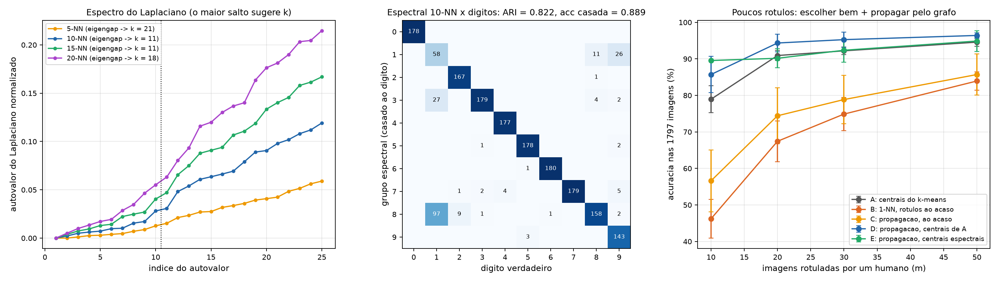

**Ablação da inicialização do k-means** (20 sementes pareadas). Nos dígitos, o k-means++ começa melhor (inércia inicial menor em 12/20 sementes com k = 10 e em 15/20 com k = 50), mas **termina igual**: o Lloyd corrige quase qualquer início porque os grupos se sobrepõem. Num **controle com 25 gaussianas bem separadas**, cujo ótimo global é conhecido, o início aleatório nunca o encontra em 50 sementes, e o k-means++ o encontra em 24%.

**Dimensão e número de grupos.**

| d (PCA) | 2 | 5 | 10 | 20 | 30 | 64 |
| --- | --- | --- | --- | --- | --- | --- |
| ARI k-means++ | 0,397 | 0,554 | 0,643 | 0,664 | 0,650 | 0,648 |
| ARI GMM completa | 0,380 | 0,583 | 0,684 | **0,773** | 0,743 | - |

Sem rótulos, cada critério escolhe um k diferente:

| critério | k escolhido |
| --- | --- |
| silhueta | 16 |
| BIC da GMM completa | 9 |
| BIC da GMM diagonal | 20 |
| eigengap do grafo 10-NN | 11 |
| maior ARI com os rótulos (k-means) | 12 |

Alguns dígitos têm dois estilos (o "1" com e sem base), e os dados de fato pedem um pouco mais de 10 grupos.

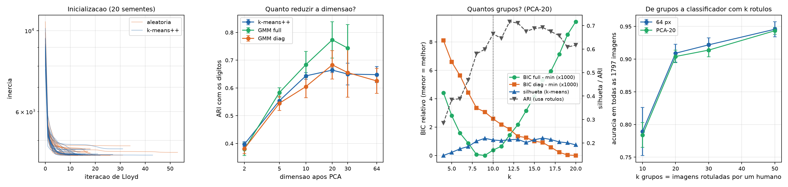

**De grupos a classificador com m rótulos** (acurácia nas 1797 imagens, 10 sementes). As cinco estratégias comparadas:

| estratégia | como escolhe as m imagens rotuladas | como estende os rótulos às outras imagens |
| --- | --- | --- |
| A | a mais central de cada um dos m grupos do k-means | cada grupo herda o rótulo da sua imagem central |
| B | sorteio | 1-vizinho mais próximo |
| C | sorteio | propagação no grafo |
| D | as **mesmas** imagens de A | propagação no grafo |
| E | as centrais dos m grupos espectrais | propagação no grafo |

| m | A | B | C | D | E |
| --- | --- | --- | --- | --- | --- |
| 10 | 0,789 | 0,462 | 0,566 | 0,857 | **0,895** |
| 20 | 0,909 | 0,674 | 0,744 | **0,943** | 0,901 |
| 30 | 0,922 | 0,749 | 0,788 | **0,953** | 0,924 |
| 50 | 0,946 | 0,839 | 0,857 | **0,964** | 0,949 |

Duas lições separadas por ablação:

1. **Escolher quem rotular importa mais que o algoritmo.** Com 10 imagens sorteadas, o 1-NN acerta 46% e a propagação 57%, porque alguns dígitos ficam sem nenhum exemplo. Com 10 imagens centrais, A já faz 79%.
2. **Propagar pelo grafo é melhor que herdar o rótulo do grupo.** D usa exatamente as mesmas imagens de A e ganha +6,77 p.p. com m = 10 (10/10 sementes), +3,43 com m = 20 (9/10), +3,07 com m = 30 (9/10) e +1,84 com m = 50 (10/10). Com **50 rótulos (2,8% das imagens) a acurácia chega a 96,4%**, e com 10 rótulos bem escolhidos (E) a 89,5% com desvio de só 0,001.

### 4. Considerações finais

**Potenciais.**

- O agrupamento espectral, escrito com uma decomposição em autovetores e um k-means, recupera os dígitos com ARI 0,82 sem nenhum rótulo, e o eigengap sugere k ≈ 10.
- Somado à propagação de rótulos, vira um classificador **semi-supervisionado** de 96% com 50 exemplos, o que mostra o valor de explorar a estrutura dos dados não rotulados.
- Os protótipos do k-means são imagens legíveis de dígitos.

**Limitações.**

- O espectral depende do número de vizinhos (ARI de 0,75 a 0,82) e usa matrizes densas n × n com decomposição O(n³): viável para 1797 imagens, não para o MNIST completo sem matrizes esparsas e Lanczos.
- O próprio "número certo de grupos" é ambíguo.
- A GMM completa é instável e não foi rodada em 64 dimensões.
- O DBSCAN só funciona bem descartando um terço dos dados.
- Na propagação, α = 0,99 e o grafo 10-NN foram fixados, sem busca.
- Conjunto pequeno (1797 imagens 8×8).

**O que mudaria:** grafo esparso com pesos gaussianos auto-ajustados (*self-tuning*), HDBSCAN e repetir no MNIST 28×28.

---

## Projeto 3 - Aprendizado por reforço: reposição de estoque

**Código:** [`03_reforco_estoque.py`](https://github.com/fsousac/portifolio-IA/blob/main/aprendizado-maquina-ia/03_reforco_estoque.py) · **Como rodar:** [README do módulo](https://github.com/fsousac/portifolio-IA/blob/main/aprendizado-maquina-ia/README.md)

### 1. Problema

Uma padaria vende um produto com **demanda Poisson que muda com o dia da semana** (médias de segunda a domingo: 3, 3, 4, 4, 7, 10, 8). Ao fim de cada dia ela vê o estoque (0 a 20, a capacidade da prateleira) e decide quantas unidades encomendar; a entrega chega na manhã seguinte. A economia do problema:

| item | valor |
| --- | --- |
| receita por venda | 10 |
| custo por unidade comprada | 4 |
| frete fixo por pedido | 12 |
| armazenagem por unidade que sobra, por noite | 0,5 |
| multa por cliente não atendido (além da venda perdida) | 2 |

Pedir pouco perde vendas; pedir muito paga armazenagem; pedir todo dia paga frete. O agente **não conhece** a demanda nem os custos: só observa estoque, dia e lucro.

**Modelagem (MDP).**

- Estado s = (estoque, dia): **147 estados**.
- Ação a ∈ {0, ..., 20 − estoque}: 1617 pares (s, a) válidos.
- Recompensa: o lucro do dia; desconto γ = 0,95.
- Tarefa contínua: uma única trajetória longa, sem episódios.

Como o simulador é nosso, P(s'|s,a) e R(s,a) são conhecidos e a **política ótima é calculada exatamente**.

**Métricas.** Toda política é avaliada **exatamente**: V^π pelo sistema linear de Bellman e o lucro médio por dia pela distribuição estacionária da cadeia, sem ruído de simulação. Reportam-se a **perda de valor**, média_s(V* − V^π)/média_s V*, e a fração de estados com ação ótima.

### 2. Algoritmos

| Algoritmo | Usa modelo? | Descrição |
| --- | --- | --- |
| Iteração de valor / de política | dado | Exatos; são a verdade de referência |
| Q-learning | não | Q(s,a) += α [r + γ max Q(s',·) − Q(s,a)] (off-policy) |
| SARSA | não | Alvo com Q(s',a') da ação realmente escolhida (on-policy) |
| **Expected SARSA** | não | Alvo com a média de Q(s',·) sob a política ε-gulosa, com menos variância que o SARSA |
| Dyna-Q | amostral | Após cada passo real, n atualizações com transições sorteadas da memória |
| **R-MAX** (Brafman e Tennenholtz, 2002) | aprendido | Conta N(s,a,s') e soma recompensas. Pares vistos menos de m vezes valem o máximo possível (R_max/(1 − γ)), o que **atrai** o agente para o desconhecido. A cada 250 dias resolve o MDP estimado por iteração de valor e age de forma gulosa, sem ε. Entrega a política de certeza-equivalente do modelo final |
| (s,S) única | dado | Pede até S quando o estoque < s; melhor par por busca exaustiva |

Detalhes do protocolo:

- Exploração ε-gulosa com ε caindo de 1 a 0,01 na primeira metade.
- Passo α = 0,1 constante (ablação) ou α = 1/n(s,a)^0,7.
- **1 milhão de dias reais** por execução e 10 sementes, rodadas em 4 processos.
- Mesmas demandas para todos os métodos com a mesma semente (comparação pareada).

```
R-MAX (a cada dia real):
  a = argmax Q(s, .);  observa r, s';  N[s,a,s'] += 1;  Rsoma[s,a] += r
  a cada 250 dias:  P^ = N / n(s,a);  R^ = Rsoma / n(s,a)
     Q = iteracao de valor com Q(s,a) = VMAX se n(s,a) < m   (otimismo)
```

**Verdade de referência.**

- Iteração de valor e de política dão o mesmo V* (5,3·10⁻¹¹) e a mesma política.
- O resíduo de Bellman é 4,5·10⁻¹³.
- R(s,a) bate com Monte Carlo (200 mil amostras).
- O lucro médio exato da política ótima (**24,455/dia**) coincide com 700 mil dias simulados (24,440).
- Nenhuma política avaliada supera V* em estado algum.

### 3. Resultados

**A política ótima tem estrutura (s,S) por dia**, como prevê o teorema de Scarf para custo fixo de pedido:

| dia da decisão | seg | ter | qua | qui | sex | sáb | dom |
| --- | --- | --- | --- | --- | --- | --- | --- |
| pede se estoque < s | 3 | 3 | 4 | 4 | 6 | 10 | 9 |
| até o nível S | 12 | 12 | 12 | 14 | 20 | 20 | 16 |

**Políticas de referência (avaliação exata).**

| política | lucro/dia | perda de V* (%) | ação ótima (%) |
| --- | --- | --- | --- |
| ótima | 24,455 | 0,00 | 100,0 |
| (s,S) única, s = 7, S = 20 | 23,704 | 5,91 | 72,1 |
| repõe a média de amanhã + 2 | 14,830 | 32,98 | 61,2 |
| aleatória (fixa) | 15,459 | 39,25 | 15,6 |
| nunca pede | −11,143 | 122,39 | 73,5 |

"Nunca pede" acerta a ação em 73,5% dos estados e perde dinheiro: a fração de acertos engana, a perda de valor não.

**Aprendizado sem modelo (1 milhão de dias, 10 sementes, média ± desvio).**

| método | lucro/dia | perda de V* (%) | ação ótima (%) |
| --- | --- | --- | --- |
| Q-learning, α = 0,1 | 23,479 ± 0,146 | 4,64 ± 0,63 | 62,0 |
| **Q-learning, α = 1/n^0,7** | **23,989 ± 0,122** | **1,40 ± 0,35** | 77,0 |
| SARSA, α = 1/n^0,7 | 23,067 ± 0,223 | 7,58 ± 1,09 | 60,2 |
| Expected SARSA, α = 1/n^0,7 | 23,040 ± 0,228 | 7,91 ± 1,26 | 59,9 |
| **Q-learning, ε fixo 0,3** | **24,145 ± 0,082** | **0,94 ± 0,18** | 78,7 |

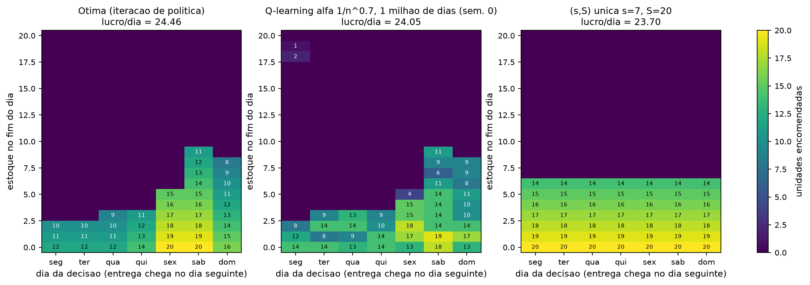

Com experiência suficiente, o Q-learning chega a **1,4% do ótimo** e a 98% do lucro ótimo por dia (23,99 de 24,46), **4 vezes mais perto do ótimo que a melhor política clássica (s,S) única** (5,9%), porque descobre que o nível de reposição depende do dia. Três efeitos se separam por ablação:

1. **α decrescente.** Reduz a perda em 3,23 p.p. em **10/10 sementes**. Com α constante, o Q oscila em torno do valor certo, porque a demanda é muito ruidosa.
2. **Exploração.** Manter ε = 0,3 até o fim dá o melhor resultado (0,94%). Com ε → 0,01, estados raros (estoque alto num sábado) deixam de ser visitados e suas ações ficam com estimativas da fase aleatória. Como o Q-learning é *off-policy*, explorar mais não estraga a política gulosa aprendida.
3. **On-policy × off-policy.** O SARSA perde 6,18 p.p. para o Q-learning (pior em 10 de 10 sementes), e o Expected SARSA não ajuda (+0,33 p.p.). O motivo: com α = 1/n^0,7 os passos ficam pequenos cedo, e os alvos on-policy carregam por muito tempo os valores da fase de exploração aleatória, enquanto o max do Q-learning os descarta. Usar a média em vez da ação sorteada reduz a variância, mas não esse viés.

**Poucos dias reais (20 mil, 10 sementes).**

| agente | lucro/dia | perda de V* (%) | ação ótima (%) |
| --- | --- | --- | --- |
| Q-learning | 18,274 ± 0,557 | 21,51 ± 1,86 | 40,3 |
| Dyna-Q n = 5 | 19,237 ± 0,289 | 23,23 ± 1,44 | 30,6 |
| Dyna-Q n = 20 | 22,107 ± 0,294 | 11,07 ± 1,10 | 51,1 |
| Dyna-Q n = 50 | 23,038 ± 0,305 | 6,04 ± 1,34 | 61,5 |
| **R-MAX, m = 5** | **23,147 ± 0,175** | **4,99 ± 0,76** | **66,1** |
| R-MAX, m = 20 | 21,743 ± 0,140 | 9,09 ± 0,56 | 68,2 |

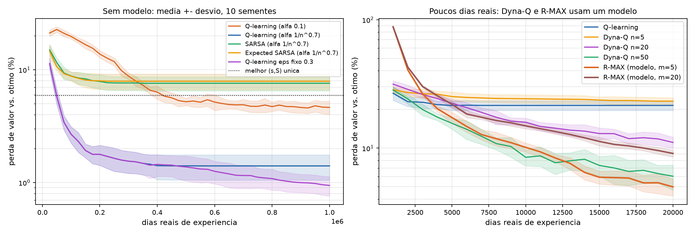

**Usar um modelo multiplica a eficiência de amostra.**

- O **R-MAX** chega em 20 mil dias a 5,0% do ótimo, enquanto o Q-learning fica em 21,5% (−16,52 p.p., melhor em 10/10 sementes). É um resultado que o Q-learning com α constante não alcança nem com 1 milhão de dias (4,6%).
- O Dyna-Q melhora com mais planejamento (n = 20: −10,44 p.p. em 10/10; n = 50: 6,0%), mas com n = 5 ainda não compensa.
- O R-MAX explora de forma **dirigida**: o otimismo leva o agente a cada par (s,a) desconhecido até vê-lo m vezes, em vez de esperar que o acaso do ε-guloso o leve lá.
- A ablação em m mostra o compromisso: m = 20 explora com mais cuidado (mais ações certas, 68,2%), mas gasta mais dias explorando e termina com 9,1%.

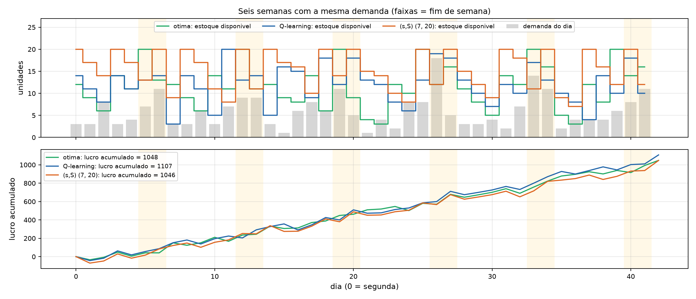

### 4. Considerações finais

**Potenciais.**

- Sem conhecer a demanda nem os custos, o Q-learning aprende uma política a 1% do ótimo que supera a regra clássica (s,S).
- Um agente com modelo (R-MAX) chega perto disso com 50 vezes menos experiência.
- Como o ambiente tem verdade exata, cada número de desempenho é uma avaliação **sem ruído**, e diferenças pequenas entre métodos são medidas com precisão.

**Limitações.**

- O ambiente é pequeno (147 estados) e tabular. Com vários produtos ou prazo de entrega maior o estado explode, e seria preciso aproximação de função: o R-MAX tabular, em particular, não escala.
- A demanda é estacionária.
- O resultado ruim do SARSA depende do esquema de α e ε escolhido. Com outro escalonamento (ε por estado, α maior no início) a diferença pode encolher.
- Hiperparâmetros (expoente 0,7, m, período de replanejamento) foram escolhidos à mão.
- Apenas 10 sementes.

**O que mudaria:** prazo de entrega de 2 dias, perecibilidade e ε por estado (1/√n(s)).

---

## Projeto 4 - Deep Learning: CNN no Fashion-MNIST

**Código:** [`04_deep_learning_cnn.py`](https://github.com/fsousac/portifolio-IA/blob/main/aprendizado-maquina-ia/04_deep_learning_cnn.py) · **Como rodar:** [README do módulo](https://github.com/fsousac/portifolio-IA/blob/main/aprendizado-maquina-ia/README.md)

### 1. Problema

O *Fashion-MNIST* (Zalando Research, público) tem **70 mil imagens 28×28** em tons de cinza de 10 classes de roupa: camiseta, calça, pulôver, vestido, casaco, sandália, camisa, tênis, bolsa e bota. Foi criado como substituto mais difícil do MNIST, porque camisa, camiseta, pulôver e casaco têm silhuetas parecidas.

A divisão é **55 mil imagens de treino, 5 mil de validação** (usadas nas curvas) **e 10 mil de teste** (usadas só no fim), com pixels normalizados pela média e pelo desvio do treino. Perguntas: (1) quanto a convolução ganha de um modelo linear e de um MLP? (2) Quais componentes da CNN moderna (BatchNorm, dropout, aumento de dados, profundidade, largura, suavização de rótulos) importam? (3) Onde a rede erra?

**Métricas.** Acurácia e entropia cruzada no teste, curvas de validação por época, diferença treino − validação (sinal de sobreajuste), matriz de confusão, acurácia por classe e os erros mais confiantes.

### 2. Algoritmos

O PyTorch fornece tensores, autograd e camadas prontas (`Linear`, `Conv2d`, `BatchNorm2d`, pooling). Foram **escritos à mão** e verificados:

| Componente | Descrição | Verificação |
| --- | --- | --- |
| Convolução por im2col | As janelas k×k viram colunas (`unfold`) e a convolução vira um produto de matrizes; usada nas duas camadas convolucionais da LeNet | = `F.conv2d` na saída e nos 3 gradientes, em 4 formas com stride e padding (diferença máx. 4,2·10⁻⁵ em float32) |
| Entropia cruzada | log-softmax estável; **suavização de rótulos** ε: alvo (1 − ε)·one-hot + ε/10 | = `F.cross_entropy` com ε = 0 e 0,1 e logits até ±100 (7,6·10⁻⁶) |
| SGD com Nesterov e decaimento de pesos | v ← μv + g + λw; w ← w − η(g + λw + μv) | = `torch.optim.SGD` após 20 passos (6,0·10⁻⁸) |
| Laço de treino | Lotes de 128, η = 0,05 com escalonamento cosseno, avaliação por época | - |
| Aumento de dados | Deslocamento de até 2 px e espelhamento horizontal, vetorizados por lote | - |
| TTA | Média dos logits da imagem e da espelhada no teste (só em redes treinadas com espelhamento) | - |
| Gradientes | - | autograd = diferenças finitas centrais numa CNN mínima em float64 (1,8·10⁻¹⁰) |

```
conv2d_im2col(x, w):                     # x: n x c x h x w,  w: co x c x k x k
  jan = x.unfold(2, k).unfold(3, k)      # n x c x ho x wo x k x k (sem copia)
  col = jan reorganizado em n x (ho*wo) x (c*k*k)
  y = col @ w.reshape(co, c*k*k)^T       # n x (ho*wo) x co
  devolve y reorganizado em n x co x ho x wo
```

**Modelos comparados.**

| Modelo | Arquitetura |
| --- | --- |
| Softmax linear | 784 → 10 |
| MLP | 784 → 256 → 128 → 10, ReLU, dropout 0,2 |
| LeNet-5 (LeCun et al., 1998) | conv 5×5 (6) → pool médio → conv 5×5 (16) → pool → 120 → 84 → 10, tanh, com a convolução própria |
| CNN-16 | 2 blocos [conv 3×3 → BN → ReLU] × 2 + max-pool (16 e 32 canais), dropout 0,1 por bloco, densa 128 com dropout 0,4, aumento de dados |
| CNN-32 | a mesma com o dobro de canais (32 e 64) e suavização de rótulos 0,1 |

Todos são treinados por **20 épocas** no treino completo (semente 0). A **ablação** usa a CNN-16 em **20 mil imagens por 15 épocas**, com 6 variantes e 2 sementes pareadas, rodadas em 4 processos de 1 thread. Com menos dados por mais épocas, a rede sem regularização consegue decorar o treino, ao contrário de um teste preliminar com orçamento curto, em que todas as variantes estavam subajustadas.

### 3. Resultados

**Comparação principal (treino completo, 20 épocas).** A coluna "acc. treino" é medida em modo de avaliação, sem dropout nem aumento, em 10 mil imagens de treino.

| modelo | parâmetros | acc. treino | acc. validação | acc. teste | teste + TTA | perda teste |
| --- | --- | --- | --- | --- | --- | --- |
| Softmax linear | 7 850 | 0,8731 | 0,8536 | 0,8450 | - | 0,4410 |
| MLP 256-128 | 235 146 | 0,9490 | 0,8980 | 0,8998 | - | 0,2887 |
| LeNet-5 (conv própria) | 61 706 | 0,9429 | 0,9138 | 0,9112 | - | 0,2490 |
| CNN-16 | 218 586 | 0,9347 | 0,9278 | 0,9275 | 0,9293 | **0,2024** |
| **CNN-32 + suavização** | 468 010 | 0,9461 | 0,9366 | **0,9346** | **0,9366** | 0,2564 |

A melhor rede chega a **93,66% no teste**: o erro cai de 15,5% (linear) para 6,3%. Como há uma semente só, a incerteza é medida no próprio teste: IC 95% por bootstrap pareado (2000 reamostragens das 10 mil imagens) e teste de McNemar exato entre modelos vizinhos, que só conta as imagens em que os dois discordam.

| modelo | acc. teste [IC 95%] | comparação (McNemar) | A acerta / B acerta | p |
| --- | --- | --- | --- | --- |
| linear | 0,8450 [0,8379; 0,8520] | - | - | - |
| MLP | 0,8998 [0,8937; 0,9056] | MLP × linear | 752 / 204 | 2,5·10⁻⁷⁴ |
| LeNet | 0,9112 [0,9056; 0,9167] | LeNet × MLP | 365 / 251 | 5,0·10⁻⁶ |
| CNN-16 | 0,9275 [0,9225; 0,9323] | - | - | - |
| CNN-32 | 0,9346 [0,9294; 0,9391] | CNN-32 × CNN-16 | 198 / 127 | 9,7·10⁻⁵ |
| | | CNN-32 × LeNet | 441 / 207 | 2,1·10⁻²⁰ |
| CNN-32 + TTA | 0,9366 [0,9314; 0,9411] | TTA × sem TTA | 54 / 34 | 0,042 |

Todas as diferenças testadas são significativas, inclusive LeNet × MLP e CNN-32 × CNN-16, apesar de os ICs vizinhos se sobreporem: o teste pareado elimina a variação comum às duas redes (imagens fáceis ou impossíveis para ambas). O ganho do TTA é pequeno e fica no limite da significância.

Leitura dos resultados:

- **Viés indutivo.** A LeNet, com **um quarto dos parâmetros do MLP**, o supera. O MLP decora o treino (94,9% contra 89,8% na validação, 5,1 p.p. de diferença), enquanto a CNN-32 mantém a diferença em 1,0 p.p. O compartilhamento de pesos da convolução é um viés melhor para imagens que conexões densas.
- **Largura.** Dobrar os canais (CNN-16 → CNN-32) ganha 0,7 p.p., e o TTA mais 0,2 p.p.
- **Perda × acurácia.** A perda de teste da CNN-32 (0,256) é maior que a da CNN-16 (0,202) apesar da acurácia maior. Não é contradição: a suavização de rótulos treina a rede para nunca dar 100% de confiança, o que **aumenta a entropia cruzada** medida contra rótulos one-hot e reduz a sobreconfiança dos erros.

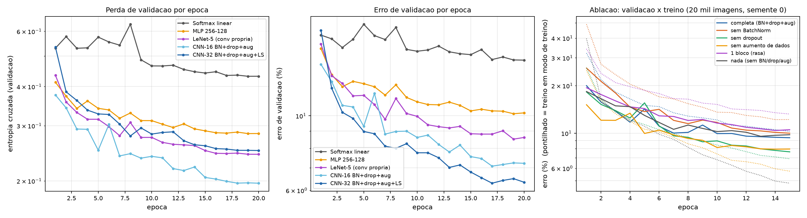

**Onde a CNN-32 erra (com TTA).**

| classe | acurácia | confusão mais frequente |
| --- | --- | --- |
| camiseta | 0,895 | camisa (76) |
| calça | 0,988 | vestido (9) |
| pulôver | 0,912 | camisa (38) |
| vestido | 0,942 | camisa (23) |
| casaco | 0,923 | camisa (37) |
| sandália | 0,980 | tênis (14) |
| **camisa** | **0,790** | camiseta (88) |
| tênis | 0,981 | bota (16) |
| bolsa | 0,988 | vestido (4) |
| bota | 0,967 | tênis (28) |

**63,9% de todos os erros (405 de 634)** ficam dentro do grupo "parte de cima": camiseta, pulôver, casaco e camisa. A camisa é a classe mais difícil (79,0%). Calçados se confundem entre si, e bolsa e calça, com silhuetas únicas, passam de 98%. Vários dos 16 erros mais confiantes da figura são ambíguos para uma pessoa em 28×28, como vestidos de alça rotulados como camiseta ou uma camiseta estampada rotulada como camisa.

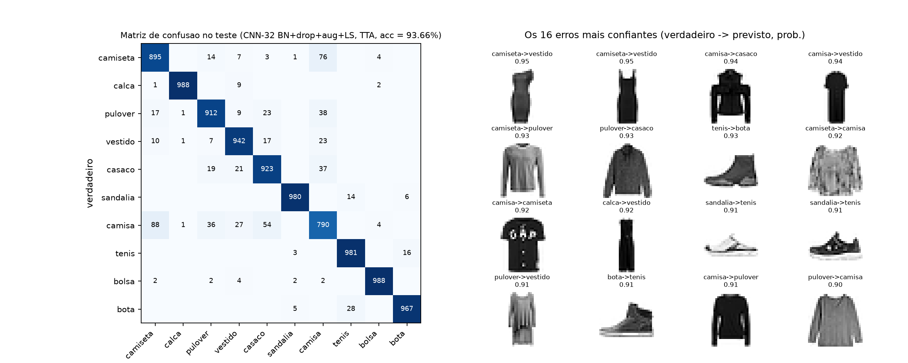

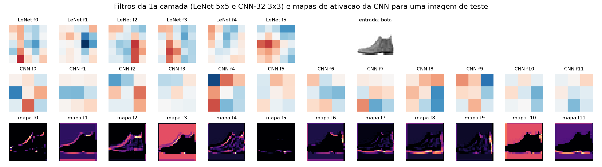

Os filtros da primeira camada são detectores de borda orientada e de contraste. Os mapas de ativação mostram canais que respondem ao contorno, a bordas horizontais ou ao interior da peça.

**Ablação** (CNN-16, 20 mil imagens, 15 épocas, sementes 0 e 1; a última coluna é a diferença treino − validação ao fim do treino).

| variante | semente 0 | semente 1 | média | vs. completa (p.p.) | treino − val. |
| --- | --- | --- | --- | --- | --- |
| completa (BN + dropout + aug) | 0,9105 | 0,9086 | 0,9095 | 0,00 | 0,0081 |
| sem BatchNorm | 0,8977 | 0,8982 | 0,8979 | **−1,16** | 0,0045 |
| sem dropout | 0,9175 | 0,9181 | 0,9178 | +0,83 | 0,0178 |
| sem aumento de dados | 0,9165 | 0,9166 | 0,9165 | +0,70 | 0,0385 |
| 1 bloco (rasa) | 0,8931 | 0,8976 | 0,8954 | **−1,42** | 0,0059 |
| nada (sem BN, dropout e aug) | 0,9033 | 0,9053 | 0,9043 | −0,52 | **0,0572** |

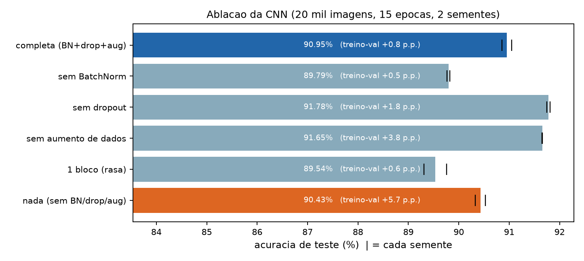

A ablação separa o papel de cada componente, e as duas sementes concordam em todas as linhas:

- **Profundidade e BatchNorm** são os componentes que mais pesam (−1,42 e −1,16 p.p. ao removê-los). A BN estabiliza a otimização com η = 0,05, e o segundo bloco dá campo receptivo para formas maiores.
- **A regularização faz o que promete sobre o sobreajuste.** Sem nenhum regularizador, a diferença treino − validação é **7 vezes maior** (5,7 p.p. contra 0,8 p.p.) e a rede completa vence a "nada" nas duas sementes. As curvas pontilhadas da figura mostram a "nada" com o menor erro de treino e um dos maiores de validação.
- **Os regularizadores são redundantes entre si.** Remover só o dropout ou só o aumento de dados **melhora** o teste (+0,83 e +0,70 p.p.), e o outro ainda segura o sobreajuste (diferenças de 1,8 e 3,8 p.p.). Usar os dois em 20 mil imagens por 15 épocas regulariza demais: a rede completa ainda tem erro de treino alto. No treino completo e mais longo da comparação principal, a combinação foi a melhor.

### 4. Considerações finais

**Potenciais.** A convolução por im2col reproduz a do PyTorch e treinou a LeNet de verdade, e o laço, o otimizador e a perda próprios chegam a **93,7% no Fashion-MNIST em CPU**. A comparação mostra o valor do viés convolucional: a LeNet vence o MLP com 4× menos parâmetros (McNemar p = 5·10⁻⁶), e o MLP sobreajusta 5 vezes mais que a CNN. A ablação, feita num regime em que há sobreajuste, mostra o que cada componente faz: BN e profundidade melhoram o ajuste; dropout e aumento de dados reduzem a diferença treino − validação.

**Limitações.** Uma única semente na comparação principal (o IC por bootstrap mede a incerteza do teste, não a do treino) e duas na ablação. O estado da arte no Fashion-MNIST (ResNets, ~95-96%) exige redes e treinos maiores que o orçamento de CPU deste trabalho: a CNN-32 levou cerca de 40 min. A ablação usa uma fração do treino, e suas conclusões sobre redundância de regularizadores valem para esse orçamento. A mesma taxa η = 0,05 serviu a todos os modelos, o que pode desfavorecer a rede sem BN, e a convolução própria é mais lenta que a nativa e só foi usada na LeNet.

**O que mudaria:** treinar com GPU por 50+ épocas, uma pequena rede residual, escolher η e a intensidade de cada regularizador por validação, e 5 sementes com intervalos de confiança.

---

## Conclusão geral

| Abordagem | Garantia | Melhor resultado | O que se aprendeu | Quando usar |
| --- | --- | --- | --- | --- |
| Árvores, florestas, boosting, stacking (proj. 1) | Nenhuma de otimalidade (CART é guloso); OOB e CV aninhada estimam o erro sem viés de seleção | 97,9% (stacking) e 97,1% (Rotation Forest) no câncer de mama; 92,9% no sintético | Cortes oblíquos e combinação de modelos vencem a RF; calibração faz o limiar de Bayes funcionar; a logística ainda empata no conjunto quase linear | Dados tabulares, fronteiras não lineares, decisão com custo |
| PCA, k-means, GMM, DBSCAN, espectral, propagação (proj. 2) | Lloyd e EM convergem a ótimos locais; o espectro do grafo conta componentes | ARI 0,82 sem rótulos; 96,4% com 50 rótulos | O grafo de vizinhos segue a forma dos grupos; escolher quem rotular e propagar pelo grafo valem mais que o algoritmo de agrupamento | Explorar dados sem rótulo e reduzir o custo de rotulagem |
| Q-learning, SARSA, Dyna-Q, R-MAX (proj. 3) | Convergência ao ótimo com α decrescente e exploração infinita; R-MAX tem garantia PAC | 0,9% do ótimo (Q-learning, 1 milhão de dias); 5,0% com 20 mil dias (R-MAX) | α decrescente e exploração são decisivos; um modelo aprendido economiza 50× em experiência real | Decisões sequenciais com modelo desconhecido |
| CNN treinada por SGD (proj. 4) | Nenhuma (não convexo); verificação por gradiente numérico | 93,7% no Fashion-MNIST | Convolução vence o MLP com 4× menos parâmetros; BN e profundidade melhoram o ajuste; regularizadores reduzem o sobreajuste, mas são redundantes entre si | Imagens e sinais com estrutura espacial, muitos dados |

**Padrões que se repetem.**

1. **Verdade independente.** Todo algoritmo escrito à mão foi comparado com uma verdade independente: scikit-learn, SciPy, PyTorch, MDP exato, propriedades do SVD, do EM e do Laplaciano.
2. **Usar estrutura vale mais que força bruta.** Cortes rodados nas árvores, o grafo de vizinhos nos dígitos, o modelo de transições no RL e a convolução nas imagens deram os maiores saltos de cada projeto, mais que aumentar o número de árvores, de inícios, de dias ou de parâmetros.
3. **A escolha honesta de hiperparâmetros importa.** A validação aninhada no boosting, o α decrescente no Q-learning e o número de vizinhos no espectral pesaram tanto quanto a família de modelos. Todo hiperparâmetro escolhido pelos dados foi escolhido sem ver o conjunto de avaliação.
4. **Resultados negativos foram mantidos e explicados.** A logística empata com o melhor ensemble no câncer de mama. O k-means++ não ajuda nos dígitos. O SARSA perde para o Q-learning. Dropout e aumento de dados juntos regularizam demais em treino curto. Cada um ganhou uma explicação e, quando possível, um experimento de controle.

**Limitações do estudo.** Os conjuntos são pequenos (569 exames, 1797 dígitos) ou o ambiente é simulado (padaria). Há poucas sementes nos experimentos caros (2 na ablação da CNN, 5 no espectral e na GMM). Tudo rodou em CPU, o que limitou o tamanho das redes e fez os scripts levarem de alguns minutos a algumas horas. As conclusões comparativas valem para esses cenários e orçamentos.
