# Métodos clássicos de IA: seis projetos de busca, otimização, satisfação de restrições e lógica

## Introdução

**Objetivo.** Este relatório documenta o módulo 9.2 (Métodos Clássicos de IA) do portfólio. A ideia é implementar, **à mão** (só Python, numpy, Pillow e matplotlib, sem bibliotecas de IA, CSP, GA ou SAT), um algoritmo de cada família clássica, aplicá-lo a um problema concreto, medir o comportamento com experimentos reproduzíveis e discutir com honestidade o que funcionou e o que não funcionou.

**Os projetos.** Cada capítulo tem quatro seções: problema, algoritmos, resultados e considerações finais.

| #   | Família                | Problema                                                                       | Script                      |
| --- | ---------------------- | ------------------------------------------------------------------------------ | --------------------------- |
| 1   | Busca informada        | Alinhamento global de DNA como busca A* (com UCS, Greedy e Weighted A*)        | `01_busca_informada.py`     |
| 2   | Busca não informada    | Rush Hour: BFS, DFS, DLS, IDDFS, UCS e bidirecional                            | `02_busca_nao_informada.py` |
| 3   | Busca complexa (local) | Layout de teclado para o português: hill climbing, recozimento simulado e beam | `03_busca_complexa.py`      |
| 4   | Algoritmo genético     | Aproximação de imagem com triângulos translúcidos                              | `04_algoritmo_genetico.py`  |
| 5   | CSP                    | Geração de cruzadinhas: backtracking, MRV, LCV, FC, AC-3/MAC e Min-Conflicts   | `05_csp.py`                 |
| 6   | Base de conhecimento   | Campo Minado por inferência lógica: KB em CNF, DPLL e encadeamento de regras   | `06_base_conhecimento.py`   |

**Como reproduzir.** Requer Python 3 (testado com 3.14) e `pip install -r requirements.txt` (numpy, matplotlib, pillow). Cada script é independente, usa seeds fixas, lê os arquivos auxiliares ao lado dele (`corpus_pt.txt`, `palavras_pt.txt`), imprime as tabelas no console, grava as figuras em `figs/` e a saída textual completa em `figs/NN_saida.txt`. Os contadores de nós, avaliações e backtracks são determinísticos; só os tempos de relógio variam com a carga da máquina (por isso o texto privilegia contagens). Os detalhes de execução estão no `README.md`.

**Critério de escolha dos problemas.** Evitou-se o repertório escolar de cada família (8-puzzle, N-rainhas, caixeiro-viajante, sudoku, mapa da Romênia). Cada problema foi escolhido para ter (i) ótimo conhecido ou verificável de forma independente (Needleman-Wunsch, BFS multi-fonte, verificador de cruzamentos), (ii) tamanho ajustável para mostrar como o custo cresce e (iii) resultado visual ou interpretável (heatmaps, tabuleiros, layouts, imagens, grades). Onde há um algoritmo exato, ele serve de verdade de referência nos `assert`.

## Índice

1. Projeto 1 - Busca informada: alinhamento de DNA como busca A\*
2. Projeto 2 - Busca não informada: Rush Hour
3. Projeto 3 - Busca complexa: layout de teclado para o português por busca local
4. Projeto 4 - Algoritmo genético: aproximação de imagem com triângulos translúcidos
5. Projeto 5 - CSP: geração de cruzadinha
6. Projeto 6 - Base de conhecimento: Campo Minado por inferência lógica
7. Conclusão geral: quando usar cada abordagem

---

## Projeto 1 - Busca informada: alinhamento de DNA como busca A\*

### 1. Problema

Dadas duas sequencias de DNA A (tamanho n) e B (tamanho m) sobre o alfabeto {A,C,G,T}, deseja-se o **alinhamento global de menor custo**, isto e, uma distancia de edicao ponderada. Em vez da programacao dinamica (DP) usual, o problema e formulado como busca em grafo:

- **Estado:** (i, j), com i caracteres de A e j de B ja consumidos. Inicial (0,0); objetivo (n,m).
- **Acoes e custos:** diagonal (i+1, j+1) com custo 0 se A[i]=B[j] (match) ou 1 (mismatch); gap em B (i+1, j) com custo 2; gap em A (i, j+1) com custo 2. Os custos sao parametros (`GAP`, `MISMATCH`).
- **Objetivo:** caminho de (0,0) a (n,m) de custo total minimo. O grafo e um DAG em grade (n+1)x(m+1).

Pergunta: uma heuristica simples acha o otimo **sem preencher a matriz inteira**, e quanto se perde ao trocar garantia por velocidade?

### 2. Algoritmos

Todos foram implementados a mao em `01_busca_informada.py`. Uma unica funcao `busca` implementa o melhor-primeiro com fila de prioridade (`heapq`) e prioridade f = wg*g + wh*h, de modo que as variantes diferem apenas nos pesos (mesma fila, mesmo desempate por maior i+j, mesma contagem de expansoes):

| Algoritmo             | (wg, wh)              | Garantia             |
| --------------------- | --------------------- | -------------------- |
| UCS / Dijkstra        | (1, 0)                | otimo                |
| A\*                   | (1, 1)                | otimo (h admissivel) |
| Weighted A* (WA*)     | (1, w), w = 1.5, 2, 3 | custo <= w \* otimo  |
| Greedy best-first     | (0, 1)                | nenhuma              |
| Needleman-Wunsch (NW) | DP completa           | otimo (referencia)   |

**Heuristica:** h(i,j) = GAP \* |(n-i) - (m-j)|. Qualquer caminho restante precisa de pelo menos |diferenca dos comprimentos restantes| gaps, cada um custando GAP, logo h e admissivel. O script verifica por `assert`, em todas as celulas de 3 pares de ~30 bases (um deles com B truncado), que ela e **consistente** e nunca supera o custo real do sufixo (calculado por NW). A heuristica so enxerga a diferenca de comprimentos, nao o conteudo das bases.

```
busca(A, B, wg, wh):
  g[(0,0)] = 0; fila = {(0,0)}
  enquanto fila nao vazia:
     s = pop(fila com menor wg*g + wh*h)      # desempate: maior i+j
     se s obsoleta: continue
     expande s (conta +1); se s == (n,m): pare
     para cada sucessor s' (diagonal, gap em B, gap em A):
         se g[s] + custo < g[s'] (Greedy: se s' nunca vista):
             g[s'] = g[s] + custo; pai[s'] = s; push(s')
  reconstroi o caminho pelos pais e recalcula seu custo (assert)
```

**Autoverificacao:** em todos os pares, o custo de A* e de UCS e comparado ao de NW com `assert`; para WA* verifica-se custo <= w\*otimo; nenhum algoritmo pode ter custo abaixo do otimo.

**Dados:** pares sinteticos com seed fixa. A e aleatoria; B e A mutada, e em cada posicao ocorre um evento com probabilidade igual a divergencia (70% substituicao, 15% delecao, 15% insercao). Comprimentos L = 50, 100, 200, 400; divergencias 5%, 15%, 30%; 3 pares por combinacao (36 pares, 216 execucoes de busca). **Metricas:** nos expandidos, fracao da matriz DP (celulas distintas expandidas / (n+1)(m+1)), tempo e custo.

### 3. Resultados

**Otimalidade.** A\* e UCS igualaram o custo do NW nos 36 pares (assert). O exemplo GATTACA x GCATGCT tem custo otimo 4.

**Esforco (L = 400, media de 3 pares).** Cada celula: nos expandidos (% da matriz DP em celulas distintas; celula reaberta conta varias vezes nas expansoes e uma so no percentual).

| Algoritmo  | div. 5%     | div. 15%     | div. 30%      |
| ---------- | ----------- | ------------ | ------------- |
| UCS        | 6017 (3.7%) | 13595 (8.5%) | 31441 (19.3%) |
| A\*        | 3017 (1.9%) | 6665 (4.1%)  | 14988 (9.2%)  |
| WA\* w=1.5 | 2814 (1.5%) | 6060 (3.3%)  | 13081 (7.3%)  |
| WA\* w=2   | 2919 (1.2%) | 6081 (2.8%)  | 12622 (6.1%)  |
| WA\* w=3   | 3288 (1.0%) | 7083 (2.3%)  | 13832 (4.6%)  |
| Greedy     | 401 (0.2%)  | 402 (0.3%)   | 405 (0.2%)    |

A razao de expansoes A*/UCS ficou entre 0.46 e 0.57 nas 12 combinacoes (L, divergencia); em L = 400 foi 0.501, 0.490 e 0.477 para 5%, 15% e 30%. Em tempo (L = 400, 30%), UCS levou 235.7 ms, A* 95.7 ms e Greedy 3.8 ms (execucao salva em `figs/01_saida.txt`); os tempos oscilam muito entre execucoes (o UCS ja mediu de 195 a 930 ms), valendo so como ordem de grandeza. As contagens de expansoes sao deterministicas (seeds fixas).

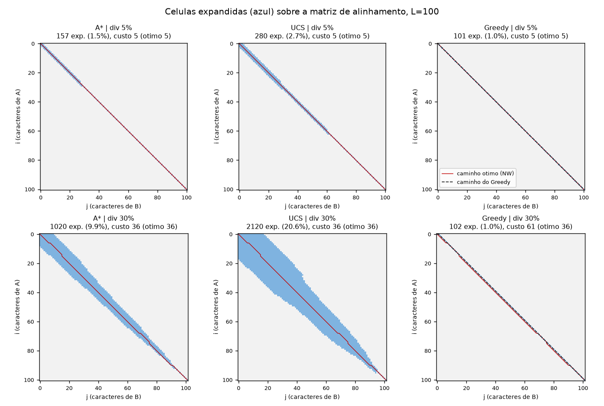

Na figura acima, com 30% de divergencia (L=100), A\* expandiu 1020 celulas (9.9%) contra 2120 (20.6%) do UCS, ambos com custo 36 (otimo). O Greedy expandiu 102 celulas, mas retornou custo 61.

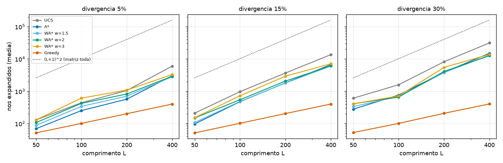

**Subotimalidade** (12 pares por celula; gap % = (custo - otimo)/otimo; entradas: subotimos / gap medio / gap maximo):

| Algoritmo  | 5%                      | 15%                       | 30%                      |
| ---------- | ----------------------- | ------------------------- | ------------------------ |
| WA\* w=1.5 | 3/12 / 3.51% / 16.67%   | 0/12 / 0% / 0%            | 1/12 / 0.10% / 1.23%     |
| WA\* w=2   | 5/12 / 10.91% / 42.86%  | 2/12 / 0.37% / 3.17%      | 4/12 / 1.26% / 8.70%     |
| WA\* w=3   | 10/12 / 32.55% / 100%   | 8/12 / 9.50% / 40.00%     | 8/12 / 6.38% / 47.83%    |
| Greedy     | 10/12 / 449.70% / 1460% | 11/12 / 193.22% / 309.68% | 12/12 / 90.48% / 117.39% |

O gap do Greedy e enorme em 5% porque o custo otimo e pequeno (denominador baixo). O Greedy expande cerca de n+1 celulas (51, 101, 202 e 401 para L = 50..400 em 5%): segue a diagonal, onde h=0, e paga mismatches em vez de abrir gaps.

**Experimento extra: bloco removido** (L=200, 5% de divergencia, B sem um bloco contiguo de k bases; 3 pares por linha):

| k   | \|n-m\| medio | UCS exp. | A\* exp. | A\*/UCS |
| --- | ------------- | -------- | -------- | ------- |
| 0   | 1             | 1741     | 878      | 0.505   |
| 10  | 10            | 3095     | 1385     | 0.447   |
| 30  | 28            | 10396    | 4067     | 0.391   |
| 60  | 59            | 15591    | 6021     | 0.386   |

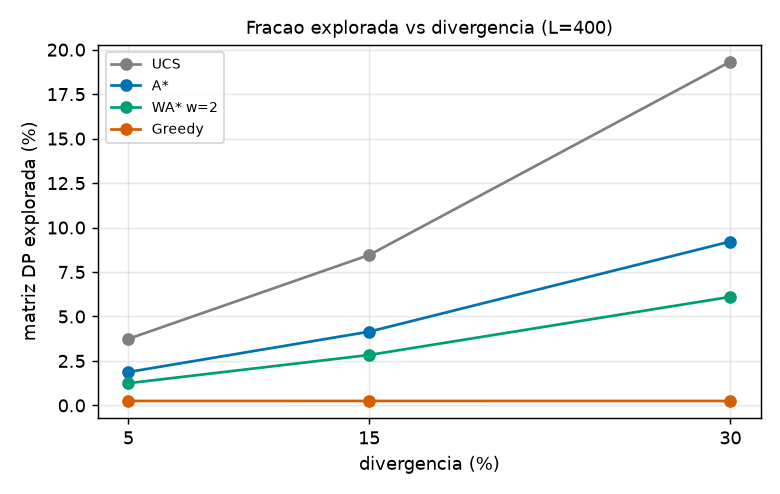

### 4. Consideracoes finais

**O que os dados mostram.** A* deu o mesmo custo do NW em todos os pares expandindo cerca de metade dos nos do UCS, e apenas 1.9% a 9.2% da matriz em L = 400. O ganho relativo foi **quase constante** (0.46 a 0.57) e nao caiu com a divergencia, o que contraria a hipotese inicial de que a heuristica so ajudaria em sequencias similares. Explicacao plausivel (nao testada isoladamente): numa celula a d diagonais do caminho principal, f ~ 2*GAP*d no A* contra GAP*d no UCS, e a banda explorada fica com metade da largura. O que muda com a divergencia e o **custo absoluto**: o custo otimo cresce e a banda com ele, de modo que o UCS vai de 3.7% a 19.3% da matriz e o A* de 1.9% a 9.2%. Com comprimentos diferentes a heuristica carrega mais informacao: a razao caiu para 0.39 quando |n-m| chegou a 59.

**Limitacoes.** (i) A heuristica ignora o conteudo das bases; por isso nao distingue regioes similares de divergentes, e o A* continua expandindo uma banda inteira ao redor do caminho, longe do minimo de ~L expansoes do Greedy. (ii) WA* nao foi monotonicamente mais barato: com 5% e w=3, expandiu 130, 612 e 1089 nos em L = 50, 100 e 200, contra 129, 439 e 1057 do UCS (causa confirmada em L = 400 e 5%: WA* w=3 fez 3288 expansoes sobre ~1690 celulas distintas, ou seja, ~1.9 por celula, por reabertura de nos; UCS e A* nao reabrem). Em L = 400 e 5%, todos os WA* ficaram abaixo do UCS. (iii) A perda de qualidade e real: w=3 foi subotimo em 26 dos 36 pares (10, 8 e 8 por divergencia), com gap de ate 100%; w=1.5 foi subotimo em 4 de 36. (iv) O Greedy e rapido, mas subotimo em 33 de 36 pares e nao serve quando a qualidade importa. (v) Com apenas 3 pares por combinacao, as medias de expansoes variam bastante (UCS em 5%: 1057 nos em L = 200 e 6017 em L = 400); a metrica mais robusta e a razao A*/UCS.

**Potencial.** A* com heuristica admissivel garante o otimo e reduziu o trabalho a cerca de metade do UCS com uma heuristica de uma linha. Ganhos maiores em alinhamento real exigiriam heuristicas que usem o conteudo das bases (por exemplo, contagem de bases restantes) ou faixas adaptativas. Para tamanhos moderados a DP de Needleman-Wunsch continua mais simples; o A* so compensa quando a matriz inviabiliza a DP completa.

## Projeto 2 - Busca não informada: Rush Hour

### 1. Problema

O Rush Hour é um quebra-cabeça de blocos deslizantes em um tabuleiro 6x6. Cada carro ocupa 2 ou 3 células, é horizontal ou vertical e só desliza ao longo do próprio eixo. O carro vermelho `X` (horizontal, linha 3) deve chegar à borda direita, ocupando as colunas 5-6. Sem estimativa de distância até o objetivo, é um caso típico de planejamento em que movimentos precisam desbloquear uns aos outros.

**Formulação.**

- **Estado:** tupla imutável (_hashable_) com a posição de cada carro ao longo do seu eixo (coluna da ponta esquerda, ou linha da ponta superior). A geometria (orientação, linha/coluna fixa, comprimento) fica fora do estado.
- **Ações:** deslizar um carro por qualquer número k >= 1 de células livres, em uma das duas direções. Cada deslize é um único movimento.
- **Custo:** 1 por movimento (definição principal). Como variante, a UCS também roda com custo igual às células percorridas. A saída do vermelho do tabuleiro não conta.
- **Objetivo:** posição do vermelho igual a 4 (índice 0-based). É um _conjunto_ de estados (os demais carros ficam em qualquer lugar), o que pesa na busca bidirecional.
- **Instâncias:** 10 tabuleiros (R01 a R10) gerados por busca reversa. Para cada layout aleatório (seed fixa), enumera-se a componente conexa de estados e roda-se uma BFS multi-fonte a partir de todos os estados resolvidos. Como os movimentos são reversíveis, escolhe-se um estado à distância desejada e o ótimo é **conhecido por construção** (5 a 30 movimentos). Há 11 a 14 carros e 5 layouts distintos (R01-R03, R04-R05, R06-R07, R08, R09-R10), com componentes de 5.599 a 28.399 estados.

### 2. Algoritmos

Todos foram implementados à mão em Python. Um nó é "expandido" quando seus sucessores são gerados; folhas da DLS e o objetivo gerado na BFS só são testados. Cada execução tem _timeout_ de 10 s e registra `TIMEOUT` ao estourar. As duas variantes do IDDFS têm, em vez disso, um orçamento **determinístico** de nós expandidos (150.000 sem tabela; 2.000.000 com tabela, nunca atingido), o que as torna reprodutíveis.

| Algoritmo    | Ideia                          | Detalhes de implementação                                                           |
| ------------ | ------------------------------ | ----------------------------------------------------------------------------------- |
| BFS          | fila FIFO por camadas          | teste de objetivo na geração; o dicionário `pai` serve de conjunto de visitados     |
| DFS          | pilha LIFO                     | busca em grafo: estado marcado ao sair da pilha, duplicatas descartadas             |
| DLS          | DFS até profundidade L         | L = 14 fixo; devolve `CORTE` quando o limite impede a solução                       |
| IDDFS        | DLS com L = 0, 1, 2, ...       | por iteração, tabela `menor profundidade vista` e reexpansão só se chegar mais raso |
| IDDFS-puro   | igual, sem tabela              | só evita ciclos no caminho atual (versão de livro)                                  |
| UCS          | fila de prioridade por custo g | teste de objetivo ao retirar; _heap_ com descarte preguiçoso                        |
| Bidirecional | duas BFS (raiz e meta)         | expande a camada inteira da menor fronteira; meta canônica                          |

**Escolhas que merecem atenção.**

1. _DLS/IDDFS com tabela._ Sem tabela, a DLS só barra ciclos no caminho e, como o mesmo estado é alcançável por muitos caminhos, o custo explode. A tabela reexpande um estado só se ele for alcançado a menor profundidade, o que preserva a otimalidade, mas troca memória O(profundidade) por memória proporcional aos estados visitados. O IDDFS-puro mantém a memória mínima e serve de contraste.
2. _Bidirecional._ O algoritmo exige um objetivo único e explícito, mas o objetivo real é um conjunto. Usei um estado-meta canônico: o estado resolvido **mais próximo** de cada instância, conhecido pela geração reversa. Uma busca real não teria essa informação, então a comparação o favorece; a seção 3 mede quanto.
3. Toda solução passa por `validar()`, verificador **independente** dos sucessores: reexecuta cada movimento numa grade de caracteres e confere que só atravessa células livres e termina no objetivo. Os _asserts_ exigem BFS = UCS = Bidirecional = ótimo conhecido, IDDFS = ótimo quando termina, e DFS/DLS >= ótimo. `conferir_sucessores()` compara o conjunto de sucessores com uma enumeração por força bruta em 300 estados por instância.

### 3. Resultados

BFS, UCS, IDDFS e Bidirecional resolveram as 10 instâncias, sempre com o número ótimo de movimentos. Os tempos de parede variam (máquina compartilhada); a comparação usa contagem de nós, reprodutível.

**Nós expandidos** (`*` = parcial: `TIMEOUT` ou, na DLS, `CORTE`):

| Inst. | Ótimo | BFS    | DFS   | DLS (L=14) | IDDFS   | IDDFS-puro | UCS    | Bidir. |
| ----- | ----- | ------ | ----- | ---------- | ------- | ---------- | ------ | ------ |
| R01   | 5     | 558    | 91    | 521        | 1.055   | 6.488      | 1.291  | 72     |
| R02   | 8     | 6.192  | 2.268 | 6.836      | 26.582  | 150.001\*  | 8.636  | 675    |
| R03   | 11    | 2.985  | 735   | 6.105      | 23.228  | 150.001\*  | 4.783  | 1.109  |
| R04   | 14    | 5.694  | 3.240 | 23.231     | 86.647  | 150.001\*  | 7.270  | 2.464  |
| R05   | 17    | 6.227  | 3.319 | 14.151\*   | 119.524 | 150.001\*  | 7.764  | 2.677  |
| R06   | 20    | 7.258  | 8.948 | 4.086\*    | 116.485 | 150.001\*  | 8.933  | 2.304  |
| R07   | 23    | 10.555 | 4.865 | 5.334\*    | 306.919 | 150.001\*  | 11.739 | 6.017  |
| R08   | 26    | 533    | 322   | 856\*      | 31.351  | 150.001\*  | 684    | 407    |
| R09   | 28    | 2.798  | 1.385 | 2.008\*    | 198.996 | 150.001\*  | 2.824  | 2.600  |
| R10   | 30    | 2.798  | 1.430 | 1.466\*    | 173.851 | 150.001\*  | 2.824  | 2.284  |

O IDDFS-puro só terminou em R01 (6.488 nós contra 558 da BFS, 11,6x) e esgotou o orçamento nas outras 9. O UCS expande um pouco mais que a BFS por só testar o objetivo ao retirá-lo da fila.

**Qualidade da solução (movimentos).** BFS, IDDFS, UCS e Bidirecional: igual ao ótimo. DFS: 90, 2.267, 732, 3.104, 2.950, 8.667, 4.688, 296, 1.344 e 1.386 (de 11,4x a 433,4x o ótimo). DLS (L=14): 14 movimentos em R01-R04 (ótimos 5, 8, 11 e 14; o primeiro caminho que coube no limite) e `CORTE` em R05-R10, cujo ótimo excede 14.

**Memória** (fronteira máxima, figura 3): BFS entre 149 e 2.553 nós; DFS entre 675 e 45.696 (de 0,9x a 26,4x a da BFS, pois a pilha guarda duplicatas); DLS e IDDFS mantêm só o caminho corrente (6 a 31 nós). Porém a tabela do IDDFS armazena tantos estados quanto a BFS (R07: 11.739 nos dois; R05: 7.719 contra 7.764).

**Variante de custo (UCS por células).** A solução difere da BFS em 6 das 10 instâncias e nunca é pior em células. Em R04 e R05 mantém os movimentos (14 e 17) e reduz as células (26 para 24; 30 para 29). Em R07 troca 4 movimentos a mais (23 para 27) por 2 células a menos (40 para 38). Em R08-R10 empata em células (36, 44, 48) com 1 a 2 movimentos a mais.

**Bidirecional sem a meta privilegiada.** Repeti a busca com 5 metas sorteadas (seed 0) entre os estados resolvidos da componente (1.572 a 5.678). O caminho médio fica de 1,2x a 3,0x acima do ótimo (R01: 15,2 contra 5; R08: 45,8 contra 26) e os nós expandidos superam os da BFS em 9 de 10 instâncias. Sem a meta próxima, o ganho some.

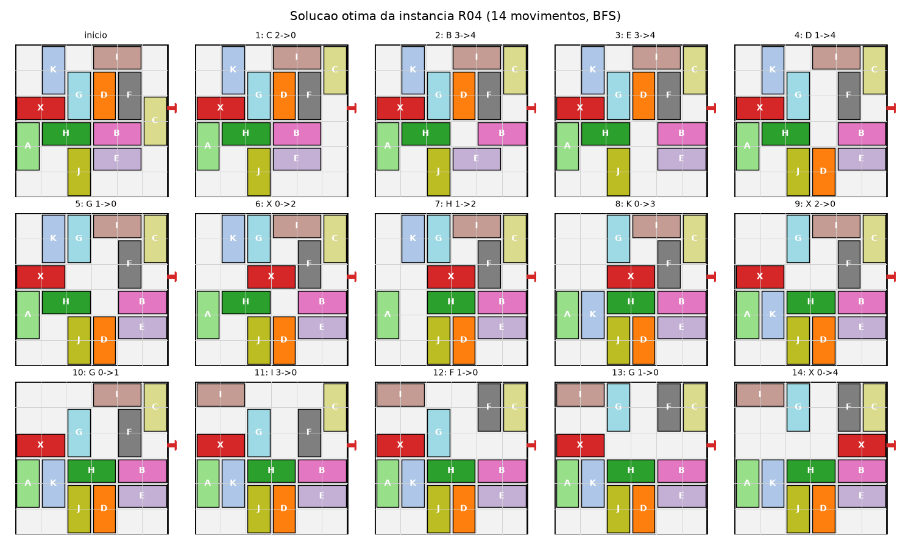

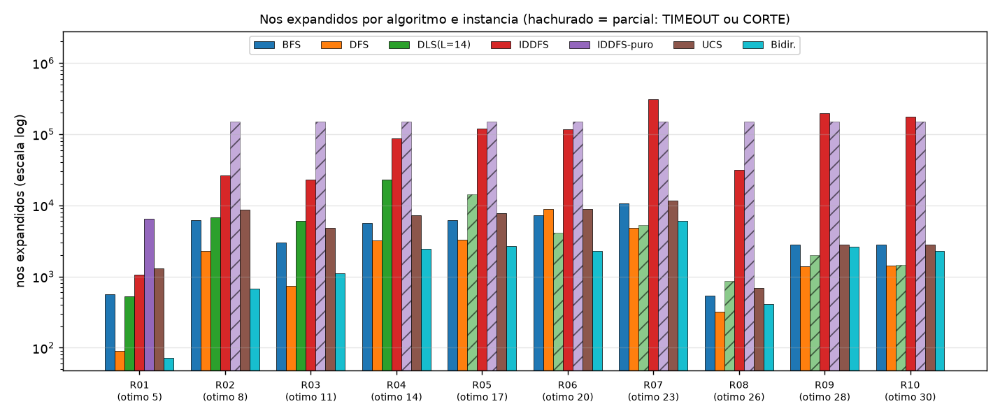

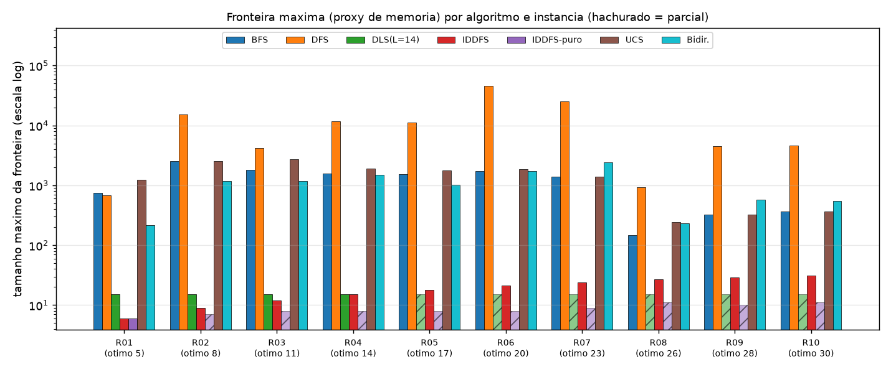

**Leitura dos números (figura 2).** Somando as 10 instâncias, a BFS expandiu 45.598 nós; UCS 56.748 (1,24x), Bidirecional 20.609 (0,45x), DFS 26.603 (0,58x) e IDDFS 1.084.638 (23,8x; de 1,9x em R01 a 71,1x em R09). A dificuldade **não** cresce com o ótimo: R08 (ótimo 26) exigiu só 533 nós da BFS, contra 10.555 em R07 (ótimo 23). Pesam mais o tamanho da componente e a ramificação (R08: 11.077 estados; R07: 25.113).

### 4. Considerações finais

**Potenciais.** BFS e UCS resolvem todas as instâncias de forma ótima em menos de 1 s, porque o espaço é pequeno (5.599 a 28.399 estados por layout) e um dicionário de visitados o cobre inteiro. O IDDFS com tabela entrega a solução ótima com fronteira de 6 a 31 nós, e o bidirecional reduziu em 55% os nós expandidos no total.

**Limitações.**

- O DFS expande menos nós que a BFS em 9 de 10 instâncias, mas suas soluções chegam a 433x o ótimo e sua fronteira é a maior de todas.
- A DLS exige acertar L: abaixo do ótimo falha, acima devolve soluções longas.
- O IDDFS sem tabela é inviável (9 de 10 esgotaram o orçamento). Com tabela, a economia de memória desaparece e a busca expande de 1,9x a 71,1x mais nós que a BFS.
- O ganho do bidirecional é **inflado**: usa a meta mais próxima, informação que só a geração reversa conhece. Com metas arbitrárias, perde a otimalidade e a vantagem (seção 3). Em R08-R10 mesmo a vantagem com meta ideal é pequena (0,8x a 0,9x da BFS).
- Nenhum método usa conhecimento do domínio; uma heurística (carros bloqueando o vermelho) reduziria a busca, assunto da busca informada.
- As 10 instâncias vêm de só 5 layouts e os tempos de parede são ruidosos; os números robustos são nós, fronteira e comprimento.

**Escalabilidade.** A BFS cabe em memória aqui (no máximo 11.739 estados). Em tabuleiros maiores o espaço cresce combinatorialmente e seria preciso um método informado ou de memória limitada.

## Projeto 3 - Busca Complexa: layout de teclado para o português por busca local

### 1. Problema

Dadas 30 teclas (26 letras, `ç`, `,`, `.`, `;`) e uma grade física 3x10, encontrar a atribuição tecla -> posição que minimize o esforço médio de digitação de português. O corpus é _Dom Casmurro_ (Machado de Assis, domínio público, Project Gutenberg), salvo em `corpus_pt.txt`: 149.984 caracteres, 118.597 toques válidos, 389 bigramas distintos entre 900 possíveis. Acentos são removidos (`ç` é mantido); espaço, dígitos e demais símbolos quebram a sequência (o espaço é do polegar).

- **Estado:** permutação das 30 teclas nas 30 posições. Espaço de busca 30! = 2,65e32.
- **Ações:** trocar duas teclas de lugar (vizinhança de 435 trocas).
- **Restrições:** cada posição recebe uma tecla. Cada coluna tem um dedo fixo (mindinho, anelar, médio, indicador, indicador | indicador, indicador, médio, anelar, mindinho); a linha 1 é a linha-base.
- **Objetivo:** minimizar o custo médio por bigrama,

```
custo(L) = soma_{a,b} F[a,b] * C[pos(a), pos(b)]        (F = frequência normalizada do bigrama a->b)
C[p,q]   = e(p) + e(q)
         + [mesmo dedo]                 * (2,0 + 1,0 * dist(p,q))
         + [mesma mão, dedos distintos] * 0,2 (+ 0,4 se saltar 2 linhas)
e(p)     = peso_dedo * dist(p, casa do dedo) + base_dedo
```

Pesos por coluna: `peso_dedo` = 1,5 / 1,2 / 1,0 / 0,8 (mindinho a indicador); `base_dedo` = 0,3 / 0,15 / 0 / 0. Distância euclidiana, passo de tecla = 1. Alternar mãos não paga penalidade de par, o que equivale a um bônus de alternância. Os pesos são escolhas de projeto (não medidos em pessoas); o custo está em unidades arbitrárias.

**Baselines:** QWERTY (ABNT2, que ocupa exatamente as 30 posições): 1,9918. Layout aleatório (2.000 amostras): média 2,2635, desvio 0,2535. O QWERTY é só 12,0% melhor que o aleatório médio nesta métrica.

### 2. Algoritmos

Tudo à mão (numpy e stdlib). Como o custo é uma soma sobre a matriz de bigramas, cada avaliação é `sum(F * C[perm][:, perm])` (cerca de 10 µs). **Comparação justa:** orçamento máximo de 30.000 avaliações, 12 sementes e, por semente, o mesmo layout inicial aleatório. Algoritmos que terminam antes (ótimo local, feixe convergido) simplesmente param.

- **HC steepest:** avalia as 435 trocas e aplica a melhor; para no ótimo local.
- **HC first-improvement:** percorre as trocas em ordem aleatória e aceita a primeira que melhora.
- **HC com reinícios:** repete o first-improvement a partir de permutações aleatórias até esgotar o orçamento.
- **Simulated Annealing (SA):** sorteia uma troca; melhora é sempre aceita e piora `d` com probabilidade `exp(-d/T)`. Devolve o melhor layout visitado (nunca pior que o inicial, verificado por `assert`). Três resfriamentos de T0 a Tf = T0/1000 em 30.000 passos: geométrico `T0 a^k`; linear `T0 - (T0-Tf) k/(n-1)`; logarítmico `T0/(1 + c ln(1+k))`, com `c = (T0/Tf - 1)/ln n`.
- **Local Beam Search (k=8):** 8 estados; cada um gera 30 vizinhos aleatórios; mantém os 8 melhores entre pais e filhos, sem duplicatas; para após 10 iterações sem melhora.

```
SA(L0):  L <- L0; melhor <- L0
  para k = 0..n-2:  (i,j) <- troca aleatória; d <- custo(L trocado) - custo(L)
     se d <= 0 ou rand() < exp(-d/T(k)): aceita (atualiza melhor)  senão desfaz
  devolve melhor
```

**Calibração:** a piora média de uma troca aleatória (100 layouts x 10 trocas) é 0,0623; T0 = 0,0899 aceita 50% dela, e Tf = 0,00009.

### 3. Resultados

Custo final por bigrama (menor é melhor); o custo médio dos iniciais é 2,2420. Todas as 84 execuções (7 algoritmos x 12 sementes) superaram o QWERTY.

| Algoritmo      | Média      | Desvio     | Mín        | Máx    | Avaliações (med.) | Redução vs QWERTY | Gap vs melhor |
| -------------- | ---------- | ---------- | ---------- | ------ | ----------------- | ----------------- | ------------- |
| HC steepest    | 0,9100     | 0,0148     | 0,8905     | 0,9353 | 11.818            | 54,3%             | 3,74%         |
| HC first       | 0,9141     | 0,0186     | 0,8790     | 0,9452 | 2.503             | 54,1%             | 4,20%         |
| HC reinícios   | **0,8842** | **0,0041** | **0,8772** | 0,8891 | 30.000            | 55,6%             | 0,80%         |
| SA geométrico  | 0,8857     | 0,0079     | 0,8775     | 0,9050 | 30.000            | 55,5%             | 0,97%         |
| SA linear      | 0,9009     | 0,0084     | 0,8843     | 0,9168 | 30.000            | 54,8%             | 2,70%         |
| SA logarítmico | 0,9062     | 0,0178     | 0,8777     | 0,9444 | 30.000            | 54,5%             | 3,30%         |
| Beam (k=8)     | 0,8963     | 0,0166     | 0,8803     | 0,9372 | 15.028            | 55,0%             | 2,18%         |

O melhor layout global (custo 0,8772, 56,0% abaixo do QWERTY) veio do HC com reinícios; o gap é relativo a ele.

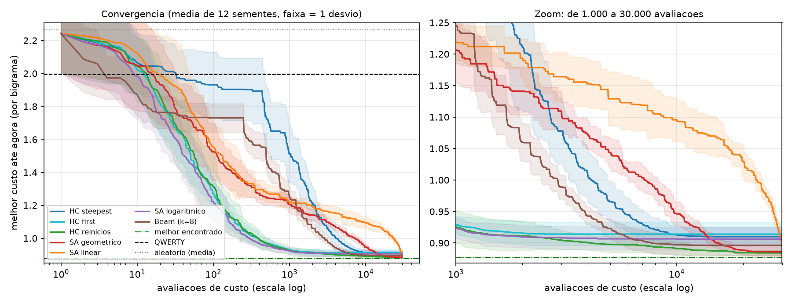

Bater o QWERTY custa pouco (média de avaliações): beam 7, SA logarítmico 11, HC first 14, HC reinícios 17, SA geométrico 20, SA linear 31, HC steepest 239. O que separa os algoritmos é a qualidade final, não a velocidade inicial.

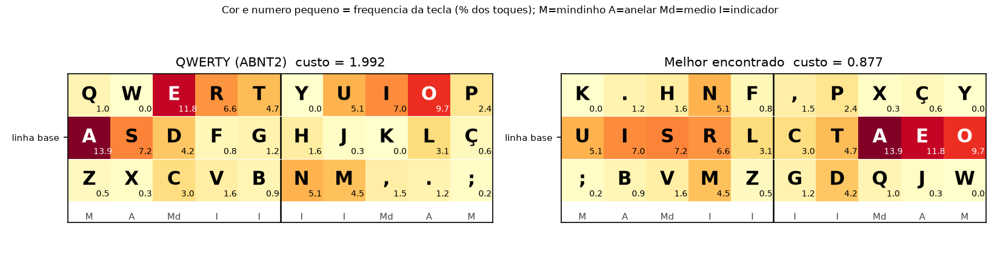

```
k . h n f , p x ç y
u i s r l c t a e o
; b v m z g d q j w
```

| Métrica                            | QWERTY | Melhor |
| ---------------------------------- | ------ | ------ |
| Bigramas no mesmo dedo (%)         | 8,10   | 1,01   |
| Bigramas alternando mãos (%)       | 51,49  | 60,70  |
| Toques na linha-base (%)           | 32,87  | 72,02  |
| Esforço individual médio por toque | 0,804  | 0,387  |

O algoritmo redescobriu um padrão ergonômico conhecido: vogais na linha-base intercaladas com consoantes frequentes (`s r t n l`); letras raras (`k w y x q j`) nas linhas de cima e de baixo.

**Ótimos locais (300 partidas de HC first):** custo médio 0,9055 (desvio 0,0199), mínimo 0,8790, máximo 0,9940; 299 layouts distintos; 2.678 avaliações em média até parar. Só 13,7% ficam a menos de 1% do melhor global; nenhum o atinge e nenhum é pior que o QWERTY. **Sensibilidade a T0** (SA geométrico, 10 sementes, Tf = T0/1000):

| T0 (x calibrado) | 0,001  | 0,01   | 0,1    | 1          | 10     | 100    |
| ---------------- | ------ | ------ | ------ | ---------- | ------ | ------ |
| Custo médio      | 0,8978 | 0,9085 | 0,8839 | **0,8815** | 0,8854 | 0,9497 |
| Desvio           | 0,0072 | 0,0323 | 0,0043 | 0,0056     | 0,0050 | 0,0134 |

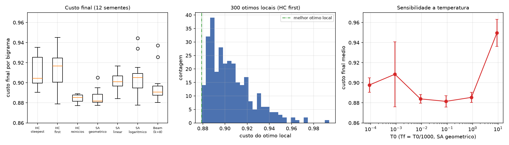

### 4. Considerações finais

**O que os resultados mostram.**

- Toda a busca local reduz o custo em 54 a 56% em relação ao QWERTY (nesta função de custo) com poucos milhares de avaliações, uma fração ínfima de 30!.
- A paisagem é rugosa: os HC simples ficam em ~0,91 (desvio 0,015 a 0,019). Reiniciar (0,8842) ou aceitar pioras temporárias (SA geométrico, 0,8857) ganha cerca de 3% e reduz o desvio a cerca de metade ou menos.
- **Temperatura:** T0 entre 0,1x e 10x do calibrado funciona (0,8815 a 0,8854). T0 muito baixo (0,001x, 0,01x) degenera em HC estocástico e prende em ótimos locais (o desvio de 0,0323 em 0,01x mostra runs bons e ruins); T0 = 100x gasta o orçamento em passeio aleatório (0,9497).
- **Resfriamento:** o geométrico venceu, mas em parte por artefato de usar o mesmo T0, Tf e n para todos. Pela fórmula, o logarítmico (c = 96,9) cai para 0,4% de T0 em 10 passos e vira quase um HC; o linear fica acima de T0/10 em ~90% dos passos e só esfria no fim. Surpresa: o logarítmico, o único com garantia assintótica, teve o pior desvio (0,0178); a garantia exige resfriamento muito mais lento que o orçamento permite.
- **Steepest vs first:** o steepest gasta 435 avaliações por passo (11.818 no total) e não superou o first (2.503): 0,9100 contra 0,9141, diferença dentro do ruído de 12 sementes.

**Limitações.**

1. **Sem garantia de ótimo.** 0,8772 é só o melhor visto. Três algoritmos chegaram a 0,8772-0,8777, o que sugere um bom candidato, mas não prova nada; nenhuma das 300 partidas de HC o atinge.
2. **Simetrias:** espelhar o layout entre as mãos ou inverter as linhas de cima e de baixo preserva o custo (verificado por `assert` no script: 0,8772063 nos três casos), então cada ótimo tem 4 cópias e "layouts distintos" superestima a diversidade.
3. **O custo é um modelo.** Pesos escolhidos por nós, alternância premiada por construção; não modelamos rolagens, polegares, modificadores, símbolos de programação nem aprendizado. Nada foi validado com digitadores.
4. **Corpus único:** um romance de 1899 pode enviesar frequências; não testamos outros gêneros.
5. **12 sementes:** diferenças menores que ~0,01 entre algoritmos não são conclusivas.

**Potenciais.** Busca local é simples, dispensa gradiente e serve para qualquer custo avaliável (aqui, 10 µs); dá boas soluções rápido, e reinícios ou SA com T0 calibrado são baratos. O preço é ajustar hiperparâmetros e aceitar a falta de certificado de otimalidade. Próximos passos: avaliação incremental do delta de uma troca (O(N) em vez de O(N²)) e um custo calibrado em dados reais de digitação.

## Projeto 4 - Algoritmo Genético: aproximação de imagem com triângulos translúcidos

### 1. Problema

Dada uma imagem-alvo T de 64x64 pixels (uma paisagem sintética gerada por código: céu em gradiente, sol com halo, duas cadeias de montanhas e um lago com reflexo), encontrar uma lista de N triângulos translúcidos cuja composição se pareça o máximo possível com T. O problema é interessante para busca evolutiva porque a função de custo depende de uma rasterização discreta e não é diferenciável em relação aos vértices, além de ter muitos ótimos locais (a ordem de desenho muda o resultado).

- **Estado (cromossomo):** matriz N x 10 com valores em [0, 1]. Cada linha é um triângulo `[x1,y1,x2,y2,x3,y3,r,g,b,a]`; o alpha real é `0,05 + 0,55*a`. A posição na lista é a ordem-z (fundo para frente).
- **Renderização:** Pillow, fundo preto, alpha blending sequencial na ordem da lista.
- **Objetivo:** minimizar `MSE(x) = média((render(x) - T)^2)` com pixels em [0, 1] (equivale a maximizar -MSE). Também reportamos PSNR = -10 log10(MSE).
- **Restrições:** genes em [0, 1] (vértices dentro da imagem) e **orçamento fixo de 40.000 avaliações de fitness por execução**, igual para todas as configurações.
- **Referências:** a imagem de cor única (média do alvo) tem MSE 0,03259 (14,9 dB); a imagem preta, 0,24597.

### 2. Algoritmos

O GA foi implementado à mão (numpy + Pillow, sem bibliotecas de GA).

**Pseudocódigo (elitista, geracional):**

```
P <- população aleatória de tamanho TAM;  avalia todos (MSE)
enquanto avaliações + (TAM - E) <= ORÇAMENTO:
    elites <- E melhores de P
    para cada um dos TAM - E filhos:
        a, b <- torneio(k=3), torneio(k=3)
        filho <- crossover(a, b) com prob. pc, senão cópia de a
        filho <- mutar(filho, pm, escala)
    avalia os filhos;  P <- elites + filhos
```

- **Seleção:** torneio de tamanho 3 (menor MSE entre 3 sorteados).
- **Crossover** (pc = 0,9): _uniforme por polígono_ (cada slot z vem de um dos pais com prob. 1/2), _ponto único_ (prefixo de um pai + sufixo do outro), ou _nenhum_ (o filho é cópia de um pai mutada).
- **Mutação:** cada polígono do filho é mutado com probabilidade `pm`. O operador é sorteado: deslocar um vértice (25%), transladar o triângulo inteiro (15%), jitter de cor (25%), jitter de alpha (15%), trocar a ordem-z com outro polígono (12%), resetar o polígono (8%). Os desvios dos jitters são 0,10 (vértice), 0,06 (translação), 0,15 (cor) e 0,20 (alpha), multiplicados por uma escala que decai linearmente de 1,0 para 0,25 ao longo do orçamento. Genes são truncados em [0, 1].
- **Elitismo:** os E melhores passam intactos. Como só os filhos são avaliados, cada geração custa TAM - E avaliações e o número de gerações depende de TAM.
- **Configuração base:** N=50, TAM=40, E=2, pm=0,05 (em média 2,5 polígonos mutados por filho), crossover uniforme.
- **Ablação:** variamos um fator por vez a partir da base (pm, TAM, tipo de crossover, N, elitismo), com 3 sementes fixas (0, 1, 2) por configuração. A mesma semente gera a mesma população inicial quando TAM e N coincidem. O custo de uma avaliação é ~0,4 a 1,7 ms (N=50, conforme a carga da máquina); as 36 execuções rodam em paralelo (`multiprocessing`) em ~190 a ~550 s (12 núcleos), e os MSEs são determinísticos (reexecução do zero reproduziu todos os valores; só os tempos variam). Autoverificações (`assert`): render determinístico, reprodutibilidade por semente, GA melhor que a cor média e MSE monotônico com elitismo.

### 3. Resultados

**Execução principal (base, semente 0):**

|     Geração | Avaliações |     MSE | PSNR (dB) |
| ----------: | ---------: | ------: | --------: |
|           0 |         40 | 0,14382 |      8,42 |
|         100 |      3.840 | 0,02823 |     15,49 |
|        1000 |     38.040 | 0,00553 |     22,57 |
| 1051 (máx.) |     39.978 | 0,00532 |     22,74 |

Em 100 gerações o GA já supera a imagem de cor única (0,0282 contra 0,0326), mas a imagem ainda é uma colagem de manchas (só há uma mancha clara onde está o sol); sol, reflexo, montanhas e lago só se definem por volta da geração 1000, e depois o ganho é incremental.

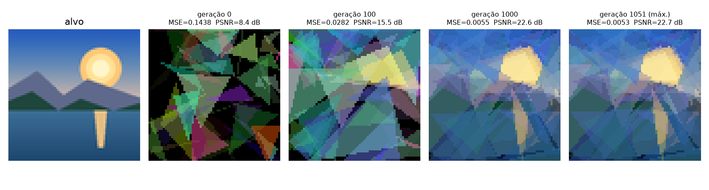

**Ablação** (MSE final, média e desvio-padrão sobre 3 sementes; orçamento de 40.000 avaliações):

| Configuração                                |   MSE médio |      dp | PSNR (dB) | Gerações |
| ------------------------------------------- | ----------: | ------: | --------: | -------: |
| base (pm=0,05; TAM=40; uniforme; N=50; E=2) |     0,00552 | 0,00049 |     22,58 |     1051 |
| pm=0,01                                     |     0,00547 | 0,00042 |     22,62 |     1051 |
| pm=0,15                                     |     0,00957 | 0,00006 |     20,19 |     1051 |
| pm=0,40                                     |     0,01735 | 0,00458 |     17,61 |     1051 |
| TAM=10                                      | **0,00322** | 0,00009 |     24,92 |     4998 |
| TAM=160                                     |     0,00838 | 0,00103 |     20,77 |      252 |
| sem crossover                               |     0,00618 | 0,00016 |     22,09 |     1051 |
| ponto único                                 |     0,00568 | 0,00063 |     22,46 |     1051 |
| N=10                                        |     0,01035 | 0,00030 |     19,85 |     1051 |
| N=25                                        |     0,00593 | 0,00072 |     22,27 |     1051 |
| N=100                                       |     0,00563 | 0,00005 |     22,49 |     1051 |
| sem elitismo (E=0)                          |     0,00658 | 0,00092 |     21,82 |      999 |

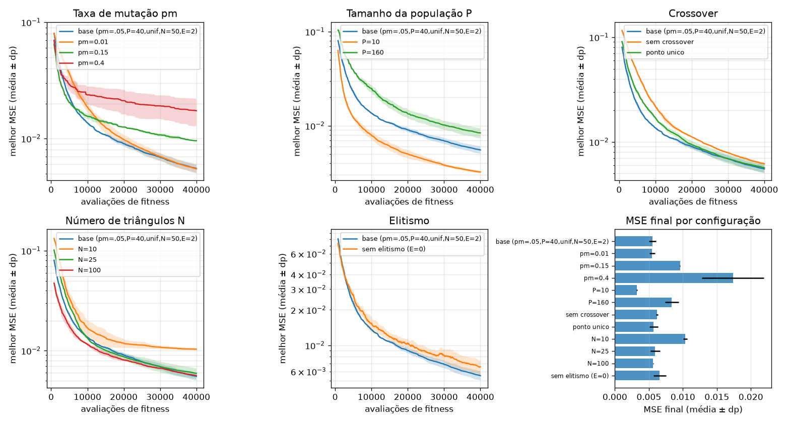

Principais observações:

- **Mutação:** pm entre 0,01 e 0,05 é equivalente (0,00547 contra 0,00552, dentro do desvio); pm=0,15 e 0,40 pioram muito, pois com 7,5 e 20 polígonos alterados por filho a herança dos bons pais é destruída. pm=0,01 (0,5 polígono por filho) começa mais lento: 0,04286 contra 0,02716 após 4.000 avaliações, e só alcança a base perto do fim.
- **População:** o resultado mais forte e, para mim, o mais surpreendente: **TAM=10 venceu com folga** (0,00322 contra 0,00552, cerca de 42% menos erro), com desvio muito pequeno. Com orçamento fixo, populações pequenas rodam muito mais gerações (4998 contra 1051 e 252). TAM=160 foi o pior dos três. Isso indica que, neste orçamento, o problema é dominado por refinamento incremental e não por diversidade.
- **Crossover:** a diferença no MSE final é pequena: uniforme 0,00552, ponto único 0,00568, sem crossover 0,00618. Só o "sem crossover" fica fora da faixa de um desvio da base, e com 3 sementes isso não é evidência forte. O efeito é mais nítido no início: após 4.000 avaliações, uniforme tem 0,0272, ponto único 0,0354 e sem crossover 0,0556. Ou seja, o crossover acelera a fase inicial (recombina polígonos úteis já achados), mas contribui pouco no refinamento.
- **Número de triângulos:** N=10 é insuficiente (0,01035, com formas grosseiras na galeria); de N=25 a N=100 o MSE é praticamente o mesmo (0,00593, 0,00552, 0,00563). N=100 converge mais rápido no começo (0,02079 contra 0,02716 em 4.000 avaliações), mas cada avaliação custa mais (mais polígonos para rasterizar) e o espaço de busca é maior.
- **Elitismo:** sem elitismo o MSE final é pior (0,00658 contra 0,00552) e o melhor da população piorou entre gerações consecutivas em 415 a 425 das ~999 gerações (cerca de 42%), enquanto com elitismo a monotonicidade foi confirmada por `assert` em todas as execuções.

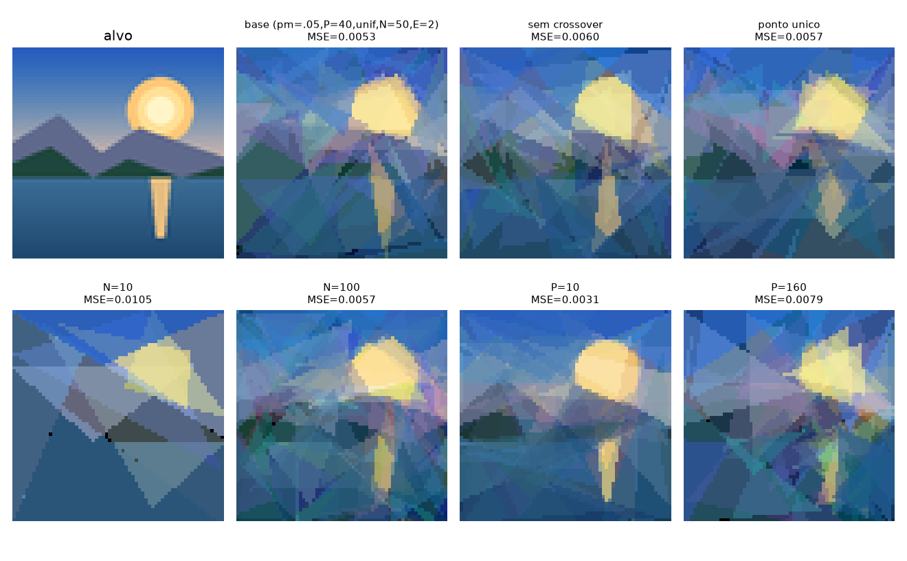

### 4. Considerações finais

**Potenciais.** O GA aproxima bem a estrutura global da cena (céu, sol, montanhas, lago com reflexo) usando só um custo de caixa-preta, chegando a 22,6 dB (base) e 24,9 dB (TAM=10) a partir de 8,4 dB na população inicial, com o alvo sintético de 64x64. O cromossomo é simples de estender (outras primitivas, outros custos como SSIM), a ablação é barata de paralelizar e o algoritmo exige pouco ajuste: pm entre 0,01 e 0,05 e N entre 25 e 100 dão resultados equivalentes.

**Limitações.**

- O desempenho ficou longe de reproduzir o alvo: detalhes finos (bordas do sol e do halo, perfil das montanhas) ficam borrados, e o MSE de 0,0053 ainda é ruído visível na imagem.
- O resultado depende do orçamento: o melhor TAM=10 é quase um hill-climber (o crossover pesa pouco), e não sabemos se a ordem se inverteria com orçamento muito maior, onde a diversidade da população pode compensar. Além disso, com TAM fixo em E=2 a fração de elite muda (20% em TAM=10, 5% em TAM=40), o que confunde parte do efeito de TAM. Não exploramos TAM<10 nem interações entre fatores (por exemplo pm x TAM); a ablação é um fator por vez.
- Apenas 3 sementes por configuração: diferenças menores que um desvio (por exemplo pm=0,01 contra 0,05, ou N=25 contra N=100) não devem ser interpretadas. Só TAM, pm alto e N=10 mostram efeitos claramente maiores que a variabilidade observada.
- O decaimento linear do passo da mutação e as probabilidades de cada operador foram fixados a priori e não foram ablacionados; a comparação de crossovers usa o mesmo esquema de mutação, que já é forte.
- O custo é dominado pela renderização; MSE em pixels não equivale à qualidade perceptual.

## Projeto 5 - CSP: geração de cruzadinha

### 1. Problema

Dada uma grade-modelo (ASCII, `#` = casa bloqueada) e um dicionário de português sem acentos, preencher todas as casas livres de modo que toda corrida horizontal ou vertical de 2 ou mais casas seja uma palavra do dicionário e não haja palavras repetidas.

- **Variáveis:** os _slots_ (corridas de tamanho >= 2), um por palavra.
- **Domínios:** palavras do dicionário com o comprimento do slot. O dicionário embutido (`palavras_pt.txt`) tem 1666 palavras de 2 a 9 letras (até 488 por comprimento); as grades usam slots de até 6 letras.
- **Restrições (todas binárias):** (a) cruzamento: a letra `i` de X é igual à letra `j` de Y; (b) diferença: dois slots de mesmo comprimento não repetem palavra (all-different decomposto em pares).
- **Objetivo:** qualquer atribuição completa e consistente (satisfação, sem custo).
- **Instâncias:** 8 grades, duas por tamanho. Foram escolhidas por amostragem, entre grades simétricas aleatórias que **têm** solução com este dicionário; (viés de seleção: grades da mesma densidade sem solução existem, ver seção 3).

| grade       | bloqueadas    | slots   | cruzamentos | grau médio  |
| ----------- | ------------- | ------- | ----------- | ----------- |
| 5x5-A / B   | 16,0%         | 10 / 10 | 21 / 19     | 4,20 / 3,80 |
| 7x7-A / B   | 18,4%         | 20 / 20 | 34 / 38     | 3,40 / 3,80 |
| 9x9-A / B   | 21,0%         | 32 / 32 | 52 / 56     | 3,25 / 3,50 |
| 11x11-A / B | 18,2% / 22,3% | 46 / 48 | 85 / 86     | 3,70 / 3,58 |

### 2. Algoritmos

Tudo foi implementado à mão (só biblioteca padrão; matplotlib apenas para as figuras). O núcleo é genérico: uma classe `CSP` (variáveis, domínios, restrições binárias com predicado `ok(a, b)`); o mesmo código resolve as 8 rainhas (BT: 113 nós e 105 backtracks; BT+MRV: 75 e 67; MAC+MRV+Grau: 20 e 12), o que confirma que não está preso à cruzadinha.

- **Backtracking (BT):** ordem estática; testa cada valor contra as variáveis já atribuídas.
- **MRV:** escolhe a variável com menos valores legais restantes. **Grau:** desempate pela variável com mais vizinhos não atribuídos.
- **LCV:** ordena os valores por quantos valores eles eliminam nos vizinhos (menos primeiro).
- **Forward Checking (FC):** ao atribuir X = a, filtra os domínios dos vizinhos livres; domínio vazio = falha imediata.
- **AC-3:** poda arcos inconsistentes até o ponto fixo. Usado como pré-processamento (`AC3+BT+MRV+FC`) e a cada atribuição (**MAC**). A revisão do cruzamento é especializada: mantém `a` se sua letra na posição `i` existe no domínio do vizinho na posição `j`, custo O(|Dx|+|Dy|).
- **Min-Conflicts:** atribuição completa aleatória; a cada passo escolhe uma variável em conflito e a move para o valor de menor número de conflitos (todos os valores do domínio são avaliados, ruído 4%), 6000 passos.

```
MAC(atrib, dom):
    se completa: devolve atrib
    x <- MRV/grau(dom);  para a em LCV(dom[x]):
        dom' <- copia(dom); dom'[x] = {a}
        se AC3(dom', arcos (y,x) dos vizinhos livres) nao esvazia nenhum dominio:
            r <- MAC(atrib+{x=a}, dom');  se r: devolve r
    devolve falha
```

**Métricas e limites.** _Nós_ = atribuições consistentes tentadas; _backtracks_ = atribuições desfeitas; _trabalho_ = valores de domínio inspecionados (proxy determinístico de custo); tempo = CPU. Cada execução tem orçamento de 30 milhões de unidades de trabalho ou 400 mil nós; ao estourar, registra-se TIMEOUT e nós/backtracks são **limites inferiores**. Toda solução passa por um verificador independente (reescreve a grade, relê as corridas por regex, confere dicionário, cruzamentos e unicidade) e um `assert` garante que nenhum método completo declara "sem solução" numa grade que outro resolveu. Conferi ainda 115 grades minúsculas por força bruta: nenhuma divergência. Sementes fixas: contadores idênticos entre execuções (só os tempos variam); execução completa em cerca de 4 min.

### 3. Resultados

**Comparação de configurações** (nós; `T(n)` = TIMEOUT com n nós, limite inferior):

| configuração                                   | 5x5-A    | 5x5-B    | 7x7-A    | 7x7-B    | 9x9-A     | 9x9-B    | 11x11-A  | 11x11-B  | resolvidas |
| ---------------------------------------------- | -------- | -------- | -------- | -------- | --------- | -------- | -------- | -------- | ---------- |
| BT                                             | T(21104) | T(20570) | T(91328) | T(66386) | T(21114)  | T(30769) | T(29911) | T(45761) | 0/8        |
| BT+MRV                                         | 1590     | 767      | T(4120)  | T(2647)  | T(3660)   | T(1709)  | T(818)   | T(911)   | 2/8        |
| BT+MRV+Grau                                    | 1790     | 771      | T(4067)  | T(2593)  | 911       | T(1703)  | T(815)   | T(911)   | 3/8        |
| BT+MRV+FC                                      | 1590     | 767      | 6401     | 14744    | T(115848) | 23872    | T(62628) | T(32854) | 5/8        |
| BT+MRV+Grau+LCV+FC                             | 1988     | 9539     | 30878    | 6731     | T(60019)  | T(58039) | T(49940) | T(29962) | 4/8        |
| AC3+BT+MRV+FC                                  | 3000     | 512      | 2979     | 1092     | 2009      | 10020    | 36445    | 65546    | 8/8        |
| MAC+MRV+Grau                                   | 86       | 25       | 28       | 25       | 166       | 51       | 327      | 169      | 8/8        |
| MAC+MRV+Grau+LCV                               | 48       | 102      | 27       | 94       | 243       | 678      | T(14087) | 541      | 7/8        |
| Min-Conflicts (passos; melhor nº de conflitos) | T(3)     | T(2)     | 4985     | T(4)     | T(6)      | T(6)     | T(15)    | T(12)    | 1/8        |

Pontos objetivos da execução:

- **MAC+MRV+Grau resolve as 8 grades**; na 11x11-B usa 169 nós, 121 backtracks e cerca de 0,1 s de CPU, contra 65546 nós e cerca de 1,4 s de `AC3+BT+MRV+FC`. O AC-3 inicial podou de 26,6% a 48,3% dos valores dos domínios antes de qualquer busca.
- **MRV sem FC tem mesmo número de nós que MRV+FC** (1590 na 5x5-A), mas custa muito mais trabalho por recontar valores legais: 12,76 M contra 0,37 M na 5x5-A (35x) e 5,58 M contra 0,22 M na 5x5-B (25x). Por isso BT+MRV estoura o orçamento com poucos nós (818 na 11x11-A).
- **LCV não ajudou de forma consistente.** Com FC melhorou a 7x7-B (6731 contra 14744 nós) e piorou a 7x7-A (30878 contra 6401) e a 5x5-B (9539 contra 767). Com MAC piorou a 9x9-B (678 contra 51) e estourou o orçamento na 11x11-A, onde MAC sem LCV usou 327 nós; o custo de calcular o suporte de cada valor supera o ganho.
- **Grau** foi decisivo em um caso: só BT+MRV+Grau resolveu a 9x9-A (911 nós) sem inferência.
- **Min-Conflicts resolveu só 1/8** (7x7-A, 4985 passos); nas demais ficou em 2 a 6 conflitos até 9x9 e 12 a 15 nas 11x11. Com 120 candidatos por passo (versão inicial) foram 0/8, então avaliar todos ajudou pouco. Uma única semente e um único ajuste: o resultado é indicativo, não definitivo.
- **Sensibilidade à ordem de valores:** a grade 9x9-A é resolvida por MAC em 166 nós, mas com outras ordens embaralhadas do dicionário 4 de 10 execuções estouraram 5 M de trabalho (tabela abaixo), sinal de cauda pesada.

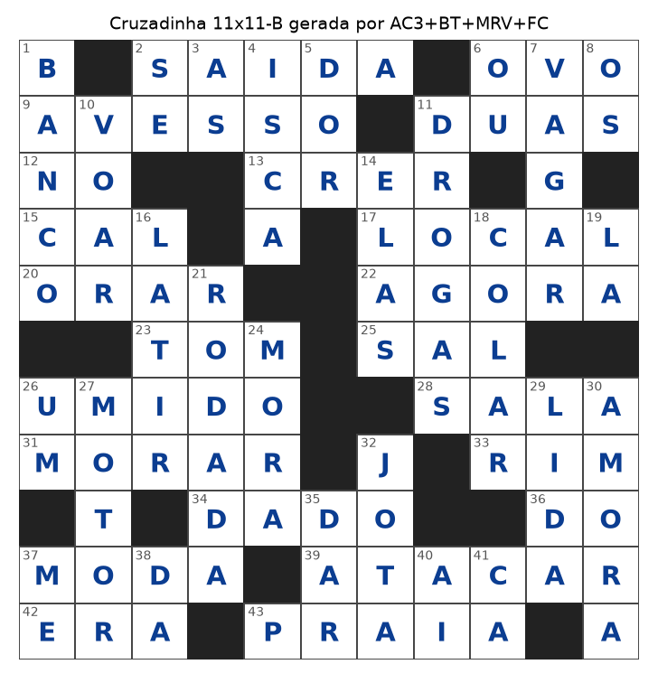

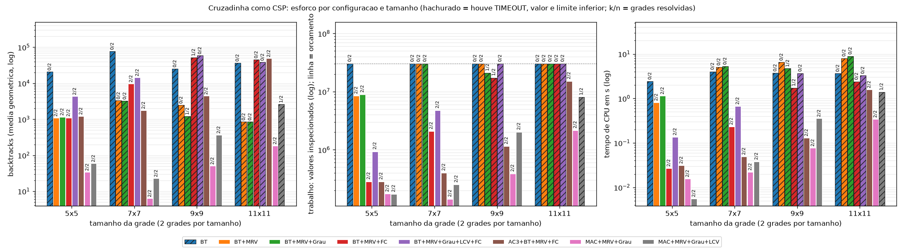

**Dicionário e densidade** (MAC+MRV+Grau, orçamento de 5 M; SAT/UNSAT provado/TIMEOUT):

| dicionário na 9x9-A (10 sorteios) | 50%    | 60%    | 70%    | 80%   | 90%   | 100%  |
| --------------------------------- | ------ | ------ | ------ | ----- | ----- | ----- |
| palavras                          | 833    | 1000   | 1166   | 1333  | 1499  | 1666  |
| SAT / UNSAT / TIMEOUT             | 0/10/0 | 0/10/0 | 0/10/0 | 2/8/0 | 7/0/3 | 6/0/4 |
| nós medianos (SAT)                | -      | -      | -      | 2424  | 1201  | 229   |

| bloqueadas (9x9 aleatórias simétricas, 12 por linha) | 14,8% | 19,8% | 24,7% | 29,6%  |
| ---------------------------------------------------- | ----- | ----- | ----- | ------ |
| slots (média)                                        | 33,3  | 31,8  | 32,8  | 29,3   |
| SAT / UNSAT / TIMEOUT                                | 2/4/6 | 7/2/3 | 9/1/2 | 12/0/0 |
| nós medianos (SAT)                                   | 700   | 52    | 45    | 32     |

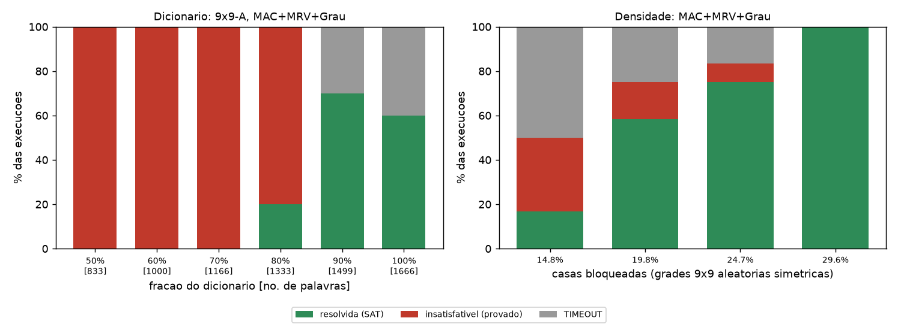

### 4. Considerações finais

**Potenciais.** Propagação faz a diferença: do BT puro (0/8 resolvidas) ao MAC+MRV+Grau (8/8, dezenas a centenas de nós) o ganho é de ordens de grandeza, e o filtro de letras por posição torna o MAC barato na cruzadinha. Nenhuma solução inválida passou pelo verificador, e o mesmo código resolve outro CSP (rainhas).

**Dicionário.** A satisfatibilidade tem transição de fase: com 50-70% das palavras, 30 de 30 instâncias foram provadas insatisfatíveis (rápido: menos de 0,25 s em média), e a partir de 80% surgem soluções. Dicionário maior facilita (mediana de 2424 para 229 nós), mas o resultado depende do vocabulário (aqui, palavras comuns).

**Densidade.** Mais bloqueios tornam a geração mais fácil (12/12 SAT com 29,6%, contra 2/12 com 14,8%), mas descaracterizam a cruzadinha: com mais casas pretas há mais slots de 2 letras (7,3 em média com 14,8% e 9,8 com 29,6%) e menos slots no total (33,3 contra 29,3). É um compromisso entre resolubilidade e qualidade da grade.

**Thrashing.** O BT estático mostra o padrão típico: quase todo nó vira backtrack (21104 nós, 21097 backtracks na 5x5-A), pois o erro real (uma palavra ruim numa região distante) só é descoberto tarde e o retrocesso cronológico revisita variáveis irrelevantes. FC e MAC antecipam o conflito. Mesmo assim BT+MRV+FC estourou o orçamento na 9x9-A com 115848 nós. Não implementamos backjumping, então não medimos seu efeito.

**Limitações.** Só 8 grades, escolhidas por terem solução; comparações por grade única são ruidosas (ex.: LCV). Resultados de TIMEOUT são limites inferiores e dependem do orçamento escolhido (30 M). Não há dicas nem grades com slots acima de 6 letras. Min-Conflicts foi testado com uma só configuração e semente.

---

## Projeto 6 - Base de conhecimento: Campo Minado por inferência lógica

### 1. Problema

Um agente joga Campo Minado enxergando apenas os números das células reveladas e deve decidir, por **raciocínio lógico**, quais células são seguras e quais são minas. Pisar numa mina encerra o jogo; vence quem revela todas as células sem mina.

- **Representação:** base de conhecimento (KB) proposicional em CNF. A variável `M(r,c)` significa "a célula tem mina" (literal negativo = negação).
- **TELL:** ao revelar uma célula com número `k`, entram na KB (a) `not M(célula)` e (b) "exatamente `k` das `n` vizinhas não reveladas são minas". Em CNF, por enumeração de combinações (`n <= 8`): para cada grupo de `n-k+1` vizinhas uma cláusula positiva (pelo menos `k` minas) e para cada grupo de `k+1` vizinhas uma cláusula negativa (no máximo `k`).
- **ASK:** `KB |= not M(x)` (segura) ou `KB |= M(x)` (mina), por **refutação**: `KB ^ M(x)` (ou `KB ^ not M(x)`) é insatisfatível?
- **Tabuleiros:** 9x9 e 16x16, densidades de 10, 15, 20 e 25% (no 9x9: 8, 12, 16 e 20 minas). O gerador nunca põe mina na célula inicial nem nas vizinhas, então a primeira jogada é segura e abre uma cascata.
- **Métricas:** taxa de vitória, % de jogadas por dedução (contra chute), tempo por jogo e chamadas ao DPLL. Todos os agentes jogam os **mesmos** tabuleiros: 500 jogos por densidade no 9x9 e 200 no 16x16.

### 2. Algoritmos

Tudo à mão (biblioteca padrão; numpy e matplotlib só para estatísticas e figuras), sem biblioteca de SAT.

**DPLL próprio.** Propagação unitária, literal puro e ramificação no primeiro literal da menor cláusula. Devolve um modelo parcial ou `None` (insatisfatível). _Resolução e DPLL são equivalentes para entailment_: ambos são refutacionalmente completos (uma refutação DPLL é uma refutação por resolução em árvore) e ambos são exponenciais no pior caso, pois SAT é NP-completo; DPLL é a forma prática (memória linear, sem cláusulas novas).

**Otimizações que não mudam o que é deduzido:**

1. os fatos (unidades) são propagados na KB inteira e a KB é trocada por uma forma equivalente e menor;
2. as cláusulas restantes são separadas em **componentes conexas**; como a KB é satisfatível (o tabuleiro real é um modelo), `KB |= alfa` só depende da componente de `alfa`;
3. cada modelo achado vira **testemunha**: se `x` foi verdadeira em algum modelo, a KB não implica `not M(x)`; se foi falsa, não implica `M(x)`.

**Encadeamento barato antes do DPLL.** Cada número revelado vira `(U, rem)`: "exatamente `rem` minas em `U`" (`U` = vizinhas desconhecidas, `rem` = número menos as minas já conhecidas). Regra de contagem: `rem = 0` torna `U` segura, `rem = |U|` torna `U` mina. Regra de subconjunto: se `U1` está contido em `U2`, então `U2 - U1` tem `rem2 - rem1` minas (0 = seguras; `|U2 - U1|` = minas). São sonoras, mas incompletas.

```
jogar():
    revela a célula inicial (segura por construção)
    enquanto houver célula sem mina não revelada:
        se há deduzida segura pendente: revela; continue
        se regras() deduziu algo: continue                  # barato
        se DPLL deduziu algo (ASK de toda a fronteira): continue
        chute na célula de menor P(mina); se for mina, perde
```

**Chute.** Para cada componente da fronteira o código enumera os modelos por DPLL, cada um com peso `w^m` (`m` = minas do modelo, `w = rho/(1-rho)`, `rho` = minas restantes / células desconhecidas), o que aproxima a contagem global de minas. `P(mina)` de uma célula é a fração ponderada de modelos em que ela é mina; células fora da fronteira recebem `(minas restantes - esperadas na fronteira)/n_interior`. Se a enumeração passa de 30 mil folhas, cai numa heurística local (maior `rem/|U|` entre os números vizinhos).

**Agentes:** _aleatório_ (só chutes uniformes); _regras_ (encadeamento + chute aleatório, sem DPLL); _regras+DPLL_ (chute aleatório, isola o efeito da dedução); _KB completo_ (regras + DPLL + chute por probabilidade).

**Autoverificação.** (i) DPLL contra força bruta em 400 CNFs aleatórias (318 satisfatíveis, 82 não); (ii) em 277 estados de tabuleiros 6x6, as deduções da KB coincidem **exatamente** com a enumeração exaustiva da fronteira (sonoridade e completude; 2405 células deduzíveis) e as regras ficam contidas nelas; (iii) cada dedução dos agentes é conferida contra o tabuleiro real: **461993 deduções, 0 falsos positivos** (um `assert` aborta na primeira). Nenhuma consulta DPLL estourou o orçamento de 200 mil nós.

### 3. Resultados

**Taxa de vitória** (%; o IC 95% binomial vai de menos de 1 até cerca de 7 pontos, ver figura):

| tabuleiro | densidade | aleatório | regras | regras+DPLL | KB completo |
| --------- | --------- | --------- | ------ | ----------- | ----------- |
| 9x9       | 10%       | 0,2       | 95,8   | 96,2        | 98,0        |
| 9x9       | 15%       | 0,0       | 86,6   | 89,0        | 91,8        |
| 9x9       | 20%       | 0,0       | 49,2   | 61,8        | 71,8        |
| 9x9       | 25%       | 0,0       | 18,4   | 28,8        | 44,4        |
| 16x16     | 10%       | 0,0       | 93,5   | 94,0        | 97,0        |
| 16x16     | 15%       | 0,0       | 78,5   | 81,0        | 89,5        |
| 16x16     | 20%       | 0,0       | 42,0   | 56,5        | 68,0        |
| 16x16     | 25%       | 0,0       | 4,5    | 9,5         | 20,5        |

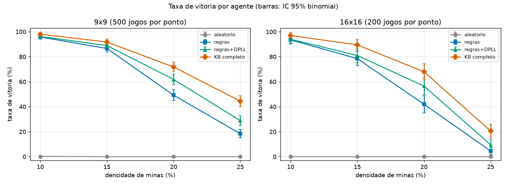

- **Dedução domina, chute é o resto.** No KB completo 9x9, a fração de jogadas por dedução cai de 99,1% (10%) para 97,9%, 94,4% e 88,9% (25%). Os chutes por jogo sobem de 0,10 para 3,07 e a fração de partidas **sem nenhum chute** cai de 91,8% para 9,4%. O agente aleatório quase nunca vence (1 vitória em 500).
- **O DPLL acha o que as regras não veem, mas é minoria.** Das deduções do KB completo 9x9, o DPLL responde por 0,4% (10%), 2,3%, 6,8% e 13,4% (25%: 1652 contra 10637 das regras). Nos estados 6x6 da verificação, as regras acharam 99,1% das células deduzíveis.
- **Regras+DPLL ganha das regras**: a 20% no 9x9, 61,8% contra 49,2%; a 25%, 28,8% contra 18,4%. No 16x16 a 25% (9,5% contra 4,5%) os intervalos se sobrepõem.
- **O chute por probabilidade pesa tanto quanto o DPLL** nas densidades altas: trocar o chute aleatório pela menor `P(mina)` dá de +2 a +16 pontos, e +10 a +16 a 20-25% (9x9: 28,8% para 44,4% a 25%; 61,8% para 71,8% a 20%). A `P(mina)` estimada nos chutes ficou entre 18% e 22% em média.

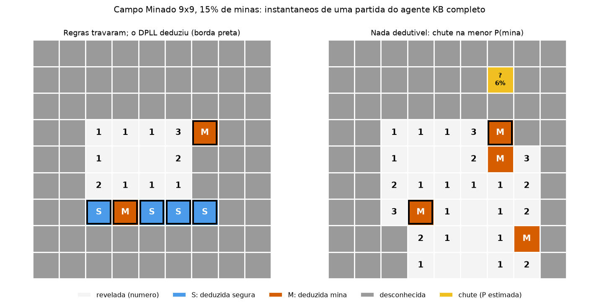

**Custo (KB completo, 9x9, ms por jogo; uma execução, os tempos variam com a máquina):**

| densidade | regras | DPLL  | chute (contagem de modelos) | chamadas DPLL/jogo | nós DPLL/jogo |
| --------- | ------ | ----- | --------------------------- | ------------------ | ------------- |
| 10%       | 0,68   | 0,04  | 0,01                        | 0,4                | 0,6           |
| 15%       | 1,30   | 0,86  | 0,44                        | 3,5                | 12,5          |
| 20%       | 2,19   | 5,12  | 9,57                        | 14,8               | 67,9          |
| 25%       | 2,55   | 13,92 | 20,58                       | 37,0               | 190,8         |

A 25%, cada célula deduzida pelas regras custa cerca de 0,12 ms e cada uma deduzida pelo DPLL cerca de 4,2 ms (35x). No 16x16 a 25%, um jogo do KB completo leva cerca de 235 ms, contra cerca de 7 ms das regras sozinhas. **Ablação:** o agente "só DPLL" (sem encadeamento), em 100 partidas a 15% no 9x9, decidiu **igual** ao KB completo em todas (93,0%), como esperado de uma dedução completa. Custou 17,1 chamadas DPLL por jogo contra 3,3 (5,15x) e 39,9 nós contra 9,9; em tempo ficou entre 1,0x e 1,4x em quatro execuções.

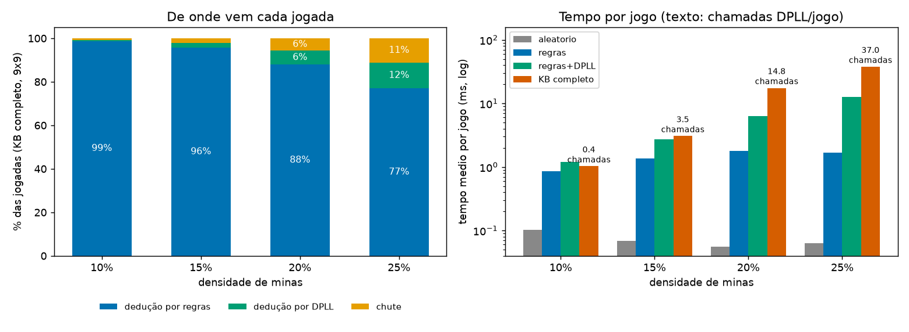

### 4. Considerações finais

**Sonoridade e completude.** As deduções são sonoras (0 falsos positivos em 461993 conferências) e completas **em relação à KB**: nos estados pequenos a KB reproduziu exatamente o entailment por enumeração, e o "só DPLL" decidiu igual ao agente com regras. Ainda assim há chutes **forçados**: quando nem `M(x)` nem `not M(x)` são implicados, nenhuma lógica resolve, e no 9x9 a 25% são 3,07 chutes por jogo. Nesses casos a taxa de vitória depende da probabilidade, não da inferência; a escolha do chute sozinha rendeu até +16 pontos.

**Custo.** O encadeamento resolve quase tudo de graça e deixa ao DPLL só o que as regras não veem. Mas DPLL é exponencial no pior caso, e o custo mostra a tendência: nós por jogo de 0,6 (10%) a 190,8 (25%), e no 16x16 o jogo passa de cerca de 34 ms (20%) para 235 ms (25%). Não medi crescimento exponencial (exigiria fronteiras bem maiores); a evidência só mostra custo crescente com densidade e fronteira. O componente mais caro nem é o DPLL, e sim a contagem de modelos do chute (20,6 ms a 25%), também exponencial: em 16 chutes de toda a bateria ela passou do limite de 30 mil folhas e o agente usou a heurística local.

**Limitações.** (i) A KB não codifica o número total de minas; ele só entra, de forma aproximada, na probabilidade do chute, então fins de jogo dedutíveis pela contagem global são chutados. (ii) A primeira jogada é sempre segura com vizinhança limpa, mais favorável que o Campo Minado padrão, e o chute é guloso (menor risco agora, não a jogada que mais informa). (iii) O 16x16 tem 200 jogos por ponto, então os intervalos são largos (até +-6,9 pontos). (iv) Contadores e taxas são reproduzíveis (sementes fixas); os tempos não. O script leva 2 a 2,5 min.

---

## Conclusão geral: quando usar cada abordagem

Os seis projetos cobrem o espectro entre **garantia** (métodos que provam otimalidade ou insatisfatibilidade) e **escala** (métodos que aceitam qualidade sem certificado). A tabela resume o que cada abordagem deu nos experimentos e quando ela vale a pena.

| Abordagem                         | Garantia                                        | O que aprendemos nos experimentos                                                                                                                                                              | Use quando                                                                                                                                                             |
| --------------------------------- | ----------------------------------------------- | ---------------------------------------------------------------------------------------------------------------------------------------------------------------------------------------------- | ---------------------------------------------------------------------------------------------------------------------------------------------------------------------- |
| Busca informada (A\*)             | Ótimo se h for admissível                       | Com heurística de uma linha, A* expandiu cerca de metade dos nós do UCS e o ganho quase não dependeu da divergência. Weighted A* e Greedy ficam mais baratos, mas subótimos                    | Há função de custo, estados enumeráveis e heurística barata e admissível; o ótimo importa e a DP completa é cara demais                                                |
| Busca não informada               | BFS/UCS/IDDFS: ótimo e completo                 | O espaço do Rush Hour era pequeno; BFS e UCS resolveram tudo. DFS falha em qualidade, IDDFS sem tabela é inviável e o bidirecional depende de conhecer o objetivo                              | Não há boa heurística, o espaço cabe em memória e um estado repetido é fácil de detectar                                                                               |
| Busca local                       | Nenhuma                                         | Todos os algoritmos superaram bem o baseline, mas a paisagem é rugosa: reinícios e SA com T0 calibrado ganham dos hill climbers simples, e o ótimo é só o melhor visto                         | O espaço é enorme, qualquer estado é uma solução válida, basta avaliar o custo e uma boa solução vale mais que uma prova                                               |
| Algoritmo genético                | Nenhuma                                         | Funcionou como otimizador de caixa-preta e capturou a estrutura global da imagem. Com o orçamento usado, o operador de crossover pesou pouco e detalhes finos ficaram borrados                 | O custo é caixa-preta ou sem gradiente, a representação é composta de partes recombináveis e há orçamento para muitas avaliações                                       |
| CSP (BT, FC, MAC)                 | Completo (prova solução ou insatisfatibilidade) | A propagação mudou a ordem de grandeza: BT puro falhou onde MAC+MRV resolveu com poucos nós. A dificuldade vem da transição de fase do dicionário e da densidade da grade                      | O problema é natural como variáveis e restrições, e a inferência local (filtrar domínios) corta o espaço cedo                                                          |
| Base de conhecimento (CNF + DPLL) | Sonora e completa em relação à KB               | Regras baratas acharam a maioria das deduções; o DPLL achou o resto a ~35x o custo por célula. A 25% de densidade ainda há ~3 chutes por jogo (vitória 44,4% no 9x9), onde a lógica não decide | O conhecimento é declarável como fatos e restrições, erros são caros e é preciso justificar cada conclusão; combine com heurística para o que a inferência não resolve |

**Padrões que se repetem.**

1. **Informação vale mais que força bruta.** A heurística no A\*, o MRV e a propagação no CSP e a calibração de T0 no recozimento atuam do mesmo modo: gastam um pouco de computação para evitar muitos estados sem futuro.
2. **Garantia tem preço.** Os métodos completos (A\*, BFS, MAC) precisam guardar estados ou domínios e sofrem quando o espaço cresce. Os métodos estocásticos (SA, GA) escalam, mas entregam "o melhor visto", e diferenças pequenas entre algoritmos exigem várias sementes para serem interpretadas.
3. **A formulação define o problema.** A escolha do estado, das ações e do custo (Rush Hour por deslize, o custo do teclado, o cromossomo de triângulos, as variáveis-slot da cruzadinha) pesou mais que qualquer ajuste fino de algoritmo.
4. **Verificação independente.** Em todos os projetos há uma referência exata ou um verificador separado (NW, BFS multi-fonte, simetrias do teclado, verificador de grade, entailment por enumeração), e isso já expôs comparações injustas e erros durante a revisão.

**Limitações do estudo.** Instâncias sintéticas e pequenas, poucas sementes em alguns experimentos (3 a 12) e tempos de relógio ruidosos. As conclusões valem para os problemas e orçamentos testados, não como ranking geral entre algoritmos.
