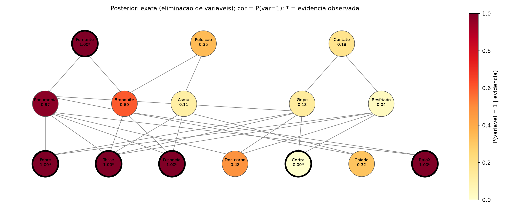
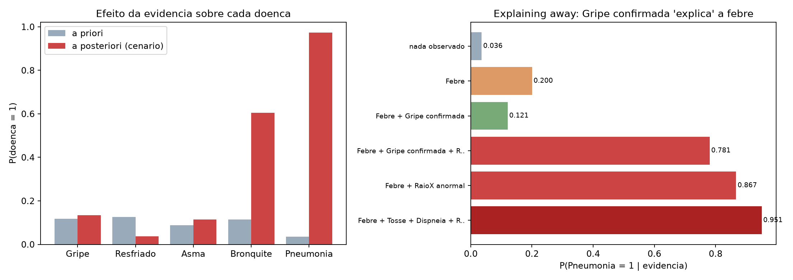
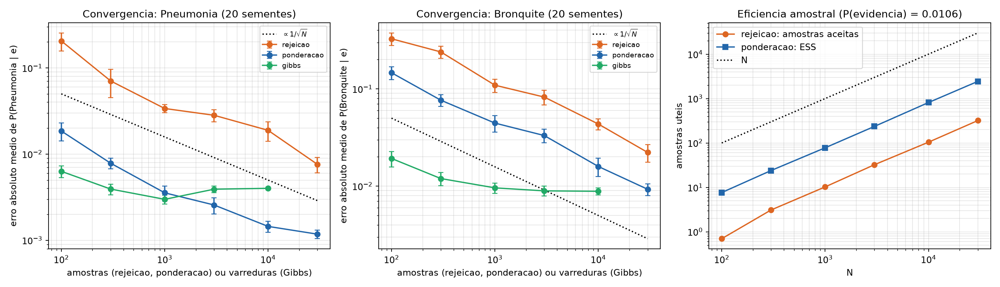
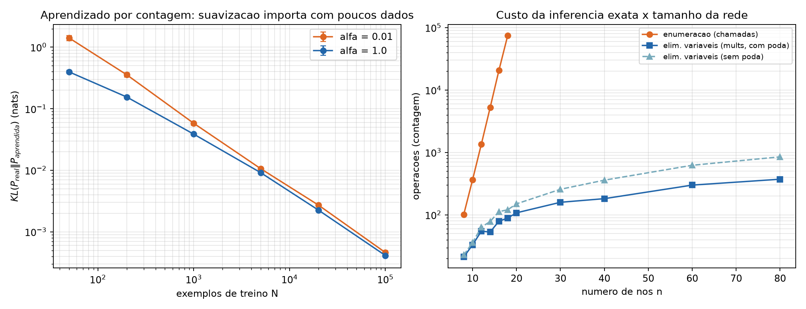
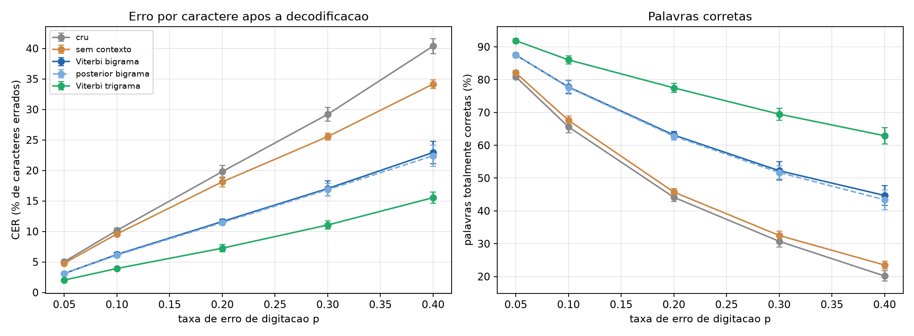
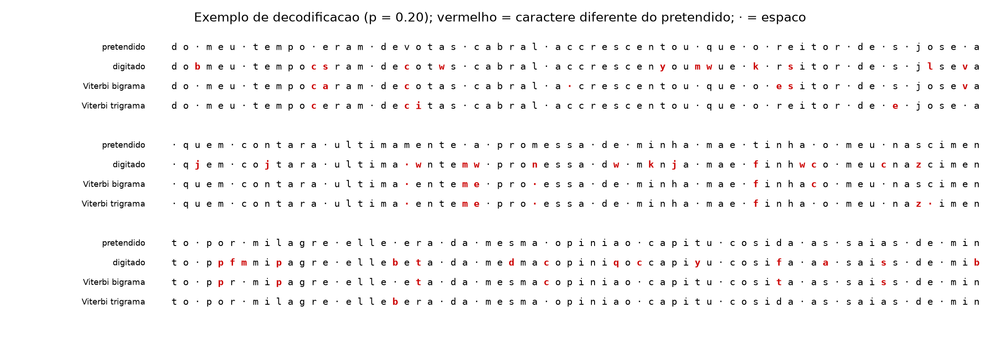
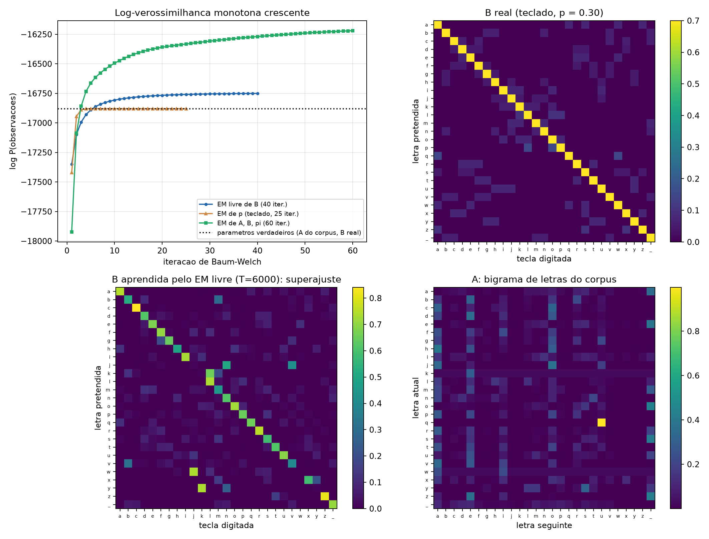
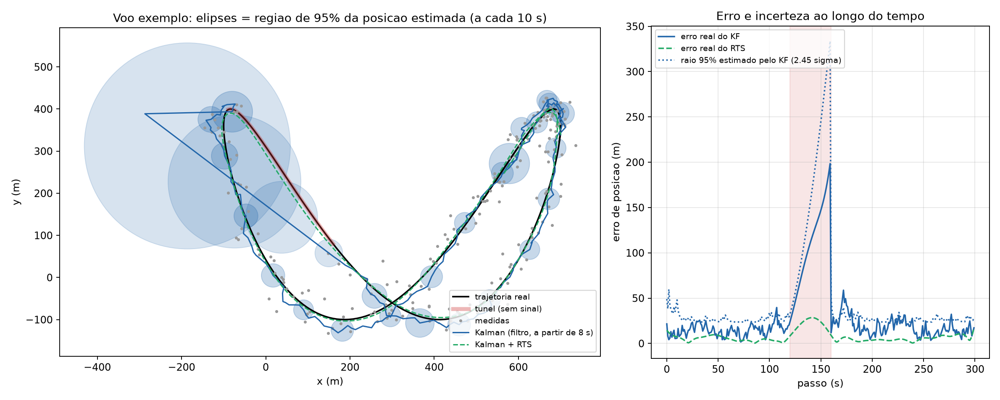
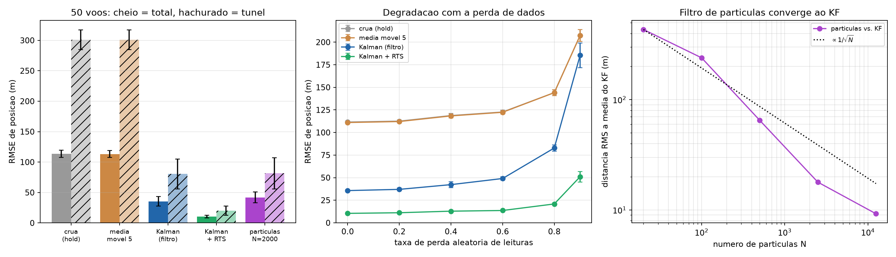
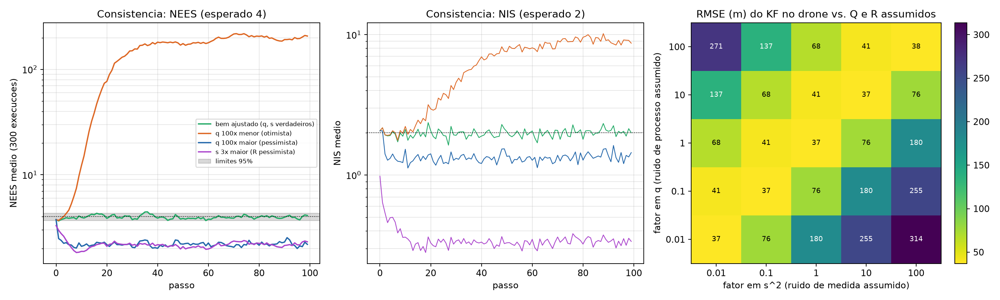

# Tratando incerteza: redes bayesianas, modelos de Markov ocultos e filtro de Kalman

## Introdução

**Objetivo.** Este relatório documenta o módulo 9.3 (Tratando Incerteza) do portfólio. Foram implementados **à mão** (só Python, numpy e matplotlib) um algoritmo de cada família de raciocínio probabilístico, cada um aplicado a um problema concreto, avaliado com experimentos reproduzíveis e discutido com as suas limitações.

**Os projetos.**

| #   | Família | Problema | Script |
| --- | --- | --- | --- |
| 1 | Redes bayesianas | Diagnóstico respiratório com 15 nós noisy-OR: inferência exata (enumeração, eliminação de variáveis), aproximada (rejeição, ponderação, Gibbs) e aprendizado de parâmetros | [`01_redes_bayesianas.py`](https://github.com/fsousac/portifolio-IA/blob/main/tratando-incerteza-ia/01_redes_bayesianas.py) |
| 2 | Modelos de Markov ocultos | Correção de erros de digitação em teclado QWERTY: forward-backward, Viterbi, Baum-Welch e HMM de 2ª ordem | [`02_hmm_digitacao.py`](https://github.com/fsousac/portifolio-IA/blob/main/tratando-incerteza-ia/02_hmm_digitacao.py) |
| 3 | Filtro de Kalman | Rastreio de um drone que atravessa um túnel sem sinal: KF, suavizador RTS, filtro de partículas, NEES/NIS | [`03_filtro_kalman.py`](https://github.com/fsousac/portifolio-IA/blob/main/tratando-incerteza-ia/03_filtro_kalman.py) |

**Como reproduzir.** Requer Python 3 e `pip install -r requirements.txt` (numpy, matplotlib). Cada script é independente, usa sementes fixas, lê o arquivo auxiliar ao lado dele (`corpus_pt.txt`, no projeto 2), imprime as tabelas, grava as figuras em `figs/` e a saída completa em `figs/NN_saida.txt`. Métricas e contagens se repetem entre execuções; só os tempos variam. Passo a passo no [README principal](https://github.com/fsousac/portifolio-IA/blob/main/README.md) e no [README do módulo](https://github.com/fsousac/portifolio-IA/blob/main/tratando-incerteza-ia/README.md).

**Critério de escolha dos problemas.** Evitou-se o repertório de livro-texto (rede do alarme/terremoto, clima do guarda-chuva, bolinha 1D). Cada problema tem (i) verdade verificável de forma independente (distribuição conjunta por força bruta; soma sobre todos os caminhos de um HMM; solução MAP em lote e fórmulas fechadas do filtro alfa-beta), (ii) tamanho ajustável e (iii) resultado visual ou interpretável. Cada projeto inclui conceitos além do básico de aula: noisy-OR, poda de nós barren, Gibbs e aprendizado (1); HMM de 2ª ordem e Baum-Welch com emissão parametrizada (2); suavizador RTS, filtro de partículas, NEES/NIS e forma de Joseph (3).

## Índice

1. Projeto 1 - Redes bayesianas: diagnóstico respiratório com noisy-OR
2. Projeto 2 - HMM: corrigindo erros de digitação
3. Projeto 3 - Filtro de Kalman: drone atravessando um túnel
4. Conclusão geral

---

## Projeto 1 - Redes bayesianas: diagnóstico respiratório com noisy-OR

**Código:** [`01_redes_bayesianas.py`](https://github.com/fsousac/portifolio-IA/blob/main/tratando-incerteza-ia/01_redes_bayesianas.py) · **Como rodar:** [README do módulo](https://github.com/fsousac/portifolio-IA/blob/main/tratando-incerteza-ia/README.md)

### 1. Problema

Um consultório quer estimar a probabilidade de cada doença respiratória a partir de fatores de risco e sintomas. A rede tem **15 variáveis binárias, 28 arestas e 3 camadas**: fatores de risco (Fumante, Poluição, Contato) → doenças (Gripe, Resfriado, Asma, Bronquite, Pneumonia) → sintomas/exame (Febre, Tosse, Dispneia, Dor_corpo, Coriza, Chiado, RaioX). Os parâmetros são plausíveis, mas **inventados** (não são dados clínicos); o objetivo é estudar inferência.

As relações causa → efeito usam **noisy-OR**: cada causa presente falha em produzir o efeito com probabilidade independente 1-p_i, e há um vazamento (leak). A rede inteira tem 43 parâmetros, contra 89 linhas de tabelas cheias e 32 767 graus de liberdade da conjunta sem estrutura (Tosse tem 5 pais: 32 linhas contra 6 parâmetros).

Perguntas: (a) quanto a evidência muda as crenças e o que é *explaining away*? (b) Quão rápido os amostradores convergem comparados com a inferência exata? (c) Quantos dados são necessários para aprender os parâmetros? (d) Como o custo da inferência exata cresce com o tamanho da rede?

### 2. Algoritmos

Tudo foi escrito com numpy (fatores com `einsum`); a verdade de referência é a **conjunta completa de 2^15 entradas construída por força bruta**.

| Algoritmo | Descrição |
| --- | --- |
| Enumeração | recursão sobre a ordem topológica somando as variáveis ocultas (ENUMERATION-ASK) |
| Eliminação de variáveis | produto de fatores e soma de cada oculta, ordem gulosa (min-fill, min-size ou aleatória), **poda de nós barren** (só ancestrais da consulta/evidência) |
| Rejeição | amostra a rede inteira e descarta o que contradiz a evidência |
| Ponderação por verossimilhança | fixa a evidência, amostra o resto e pondera por P(e \| pais) |
| Gibbs | reamostra cada oculta dado seu manto de Markov, estimador Rao-Blackwell, queima de 200 varreduras |
| Aprendizado | CPT = (contagem + α) / (total + 2α), estrutura conhecida |

```
eliminacao(consulta, evidencia):
  fatores = CPTs dos nos relevantes, com a evidencia ja aplicada
  enquanto houver oculta v:   v = proxima pela heuristica (min-fill)
     f = produto dos fatores que contem v;  fatores += soma_sobre_v(f)
  retorna produto dos fatores restantes, normalizado
```

**Autoverificação (assert):** CPTs somam 1; a conjunta soma 1; enumeração, eliminação e força bruta coincidem (tolerância 1e-10) nas **15 marginais posteriores**; *explaining away* (Gripe confirmada reduz P(Pneumonia \| Febre)); ponderação supera rejeição em N=1000 e Gibbs/ponderação convergem; o KL do aprendizado decresce com N; enumeração cresce exponencialmente e a eliminação não.

### 3. Resultados

**Cenário** (fumante, febre, tosse, dispneia, raio-X anormal, sem coriza; P(evidência) = 0,01062):

| Doença | a priori | a posteriori |
| --- | --- | --- |
| Gripe | 0,1180 | 0,1348 |
| Resfriado | 0,1260 | 0,0368 |
| Asma | 0,0882 | 0,1141 |
| Bronquite | 0,1136 | 0,6041 |
| Pneumonia | 0,0356 | 0,9729 |



**Explaining away.** Febre sozinha eleva P(Pneumonia) de 0,036 para 0,200; se a Gripe é confirmada, a febre fica "explicada" e P(Pneumonia) cai para 0,121. Se além disso o raio-X é anormal, sobe a 0,781 (sem a Gripe confirmada, Febre + RaioX dá 0,867). Com Febre, Tosse, Dispneia, RaioX anormal e Fumante, chega a 0,9506.



**Amostradores** (20 sementes; erro absoluto médio de P(consulta=1 \| e)). A evidência é rara (1,06%), então a rejeição aceita só 10,2 de 1000 amostras:

| N | rejeição (aceitas) | ponderação (ESS) | Gibbs (varreduras) |
| --- | --- | --- | --- |
| 100 | 0,2054 (0,7) | 0,0185 (8) | 0,0063 |
| 1000 | 0,0338 (10,2) | 0,0036 (78) | 0,0030 |
| 10000 | 0,0189 (104,2) | 0,0015 (814) | 0,0040 |
| 30000 | 0,0076 (319,7) | 0,0012 (2435) | - |

Consulta Pneumonia (P = 0,9729). Para a consulta Bronquite (P = 0,6041, mais incerta) em N = 1000: rejeição 0,1090, ponderação 0,0445, Gibbs 0,0096; em N = 10000: 0,0435, 0,0159 e 0,0089.



A ponderação reduz o erro frente à rejeição com o mesmo N (~9x em Pneumonia, ~2,4x em Bronquite, N = 1000), porque aproveita todas as amostras (ESS 78 contra 10 aceitas em N = 1000). O **Gibbs começa melhor, mas estaciona** em ~0,004 (Pneumonia) e ~0,009 (Bronquite): as amostras são correlacionadas e a cadeia não decai como 1/√N. Não investiguei a causa; a hipótese é mistura lenta entre configurações das doenças correlacionadas.

**Aprendizado** (10 sementes; KL da conjunta real à aprendida, nats):

| N | KL (α=0,01) | KL (α=1) | erro em P(Pneumonia\|e) |
| --- | --- | --- | --- |
| 50 | 1,4143 | 0,3972 | 0,0659 |
| 1000 | 0,0580 | 0,0387 | 0,0163 |
| 20000 | 0,0027 | 0,0023 | 0,0021 |
| 100000 | 0,0005 | 0,0004 | 0,0008 |

A suavização de Laplace reduz o KL em 3,6x com N = 50 e a diferença some com N grande. O KL cai ~ 1/N, como esperado para estimadores de máxima verossimilhança.

**Escala** (redes noisy-OR aleatórias, treewidth limitada, 5 redes por n, 3 evidências):

| n | enumeração (chamadas) | eliminação (mults, com poda) | sem poda | maior fator |
| --- | --- | --- | --- | --- |
| 8 | 102 | 21 | 23 | 8 |
| 12 | 1357 | 55 | 64 | 32 |
| 18 | 74552 | 89 | 121 | 32 |
| 40 | - | 182 | 360 | 32 |
| 80 | - | 373 | 850 | 32 |



A enumeração multiplica o custo por ~3,6 a cada 2 nós (exponencial); a eliminação cresce de forma aproximadamente linear porque o maior fator fica em 32 entradas. A poda de barren reduz os produtos em até 2,3x (n = 80).

**Ablação da ordem de eliminação** (rede clínica): min-fill e min-size → maior fator 32, 156 multiplicações (196 sem poda); ordem **aleatória** (20 sementes) → maior fator 60,8 e 285 multiplicações (518 sem poda), ou seja 1,8x (2,6x sem poda) mais caro.

### 4. Considerações finais

**Potencial.** A rede bayesiana separa modelagem e inferência: com 43 parâmetros noisy-OR, a mesma rede responde a qualquer consulta. A eliminação de variáveis é exata e barata quando o treewidth é pequeno, e os amostradores dão uma alternativa quando não é. O noisy-OR torna a rede **especificável por um especialista e aprendível** (poucos parâmetros por nó).

**Limitações.** (i) Parâmetros inventados: os números clínicos não valem; (ii) variáveis binárias e estrutura conhecida (não se aprendeu a estrutura); (iii) o experimento de escala usa redes com treewidth limitada por construção; em redes densas a eliminação também é exponencial; (iv) rejeição e ponderação ficam ruins com evidência muito rara/improvável, e o Gibbs foi implementado em Python puro (1,3 s por cadeia de 10 200 varreduras), com 20 sementes; (v) o plateau do Gibbs não foi diagnosticado (sem múltiplas cadeias nem R-hat). **O que mudaria:** aprender também os parâmetros noisy-OR por EM e comparar com tabelas cheias com poucos dados, e testar Gibbs em blocos.

---

## Projeto 2 - HMM: corrigindo erros de digitação

**Código:** [`02_hmm_digitacao.py`](https://github.com/fsousac/portifolio-IA/blob/main/tratando-incerteza-ia/02_hmm_digitacao.py) · **Como rodar:** [README do módulo](https://github.com/fsousac/portifolio-IA/blob/main/tratando-incerteza-ia/README.md)

### 1. Problema

Um texto em português é digitado num teclado QWERTY e, com probabilidade p, cada tecla sai errada: o digitador aperta uma **tecla vizinha** da correta (ex.: `a` → `s`, `q`, `w` ou `z`). Dado só o texto digitado, recuperar o texto pretendido. Não é um corretor de dicionário: o modelo só conhece estatística de letras.

**Modelagem:** estados ocultos = letra pretendida (27 símbolos: a-z e espaço); observações = tecla apertada (mesmos 27 símbolos); transição A = bigrama de letras estimado do corpus (Dom Casmurro, domínio público; 139 399 símbolos; 80% para treino e **20% finais para teste**); emissão B = canal do teclado (acerta com 1-p; senão uma vizinha uniforme; vizinhas calculadas a partir de coordenadas das teclas). **Limite:** só há erros de substituição (sem tecla a mais ou a menos), o que mantém estados e observações alinhados no tempo. Métricas: taxa de erro por caractere (CER) e % de palavras totalmente corretas, em 5 trechos de 3000 caracteres por p.

### 2. Algoritmos

Todos em numpy: **forward e backward escalonados** (T de milhares sem underflow), **Viterbi** em log, decodificação **posterior** (argmax de γ_t), **Baum-Welch** e **Viterbi de 2ª ordem**.

```
forward:  alpha_1 = pi * B[:,o_1];  alpha_t = (alpha_{t-1} A) * B[:,o_t]   (normaliza, guarda c_t)
Baum-Welch: E: gamma_t, xi_t(i,j) = alpha_t(i) A_ij B_j(o_t+1) beta_t+1(j)/c_t+1
            M: A_ij = soma_t xi/ soma_t gamma;  B_j(k) = soma_{o_t=k} gamma / soma gamma
2a ordem:  estado = (letra anterior, atual); P(c|a,b) = (C3[a,b,c] + 5*A[b,c]) / (C2[a,b] + 5)
```

Variantes de Baum-Welch: (a) **EM livre** de B (729 parâmetros); (b) **EM de p**, com B restrita à forma do teclado e um só parâmetro (M-step: p = fração esperada de posições erradas); (c) EM de A, B e π. Em (a) e (b), A fica fixa; os três usam só o texto digitado, sem rótulos.

**Verdade de referência / assert:** forward = soma sobre todos os 3^7 caminhos e Viterbi = melhor caminho (HMM pequeno); γ soma 1 e ξ marginaliza em γ; Viterbi 2ª ordem = força bruta e = Viterbi de 1ª ordem quando o trigrama é construído do bigrama; log-verossimilhança monótona no EM; HMM tem CER menor que o texto cru e que o decodificador sem contexto em p ≥ 0,10.

### 3. Resultados

**CER (%)**, média ± desvio em 5 trechos de 3000 caracteres:

| p | cru | sem contexto | Viterbi bigrama | posterior bigrama | Viterbi trigrama |
| --- | --- | --- | --- | --- | --- |
| 0,05 | 5,05 ± 0,20 | 4,79 ± 0,21 | 3,10 ± 0,18 | 3,08 ± 0,20 | 2,02 ± 0,17 |
| 0,10 | 10,17 ± 0,39 | 9,59 ± 0,28 | 6,22 ± 0,35 | 6,12 ± 0,35 | 3,93 ± 0,10 |
| 0,20 | 19,81 ± 1,01 | 18,13 ± 0,81 | 11,63 ± 0,38 | 11,45 ± 0,41 | 7,25 ± 0,59 |
| 0,30 | 29,20 ± 1,13 | 25,55 ± 0,56 | 17,03 ± 1,22 | 16,85 ± 1,00 | 11,05 ± 0,66 |
| 0,40 | 40,38 ± 1,22 | 34,16 ± 0,71 | 22,93 ± 1,81 | 22,41 ± 1,73 | 15,54 ± 0,91 |

**Palavras corretas (%)** nas mesmas execuções: com p = 0,20, texto cru 44,1; bigrama 63,1; trigrama 77,5. Com p = 0,40: 20,2; 44,7; 62,9.



O contexto de 1 letra corta o erro em ~41% (p = 0,20: 19,81 → 11,63) e o de 2 letras em ~63% (→ 7,25). O Viterbi (melhor sequência) e a decodificação posterior (melhor letra por posição) diferem em ≤ 0,5 ponto. Sem contexto, só o prior de letras ajuda pouco (18,13). O trigrama melhora o bigrama em todos os p (de 1,08 ponto em p = 0,05 a 7,39 em p = 0,40; comparação pareada), mesmo com apenas 111 519 letras de treino para 19 683 contextos (por isso o backoff).

**Exemplo** (p = 0,20): digitado `accrescenyoumwue k rsitor`; bigrama → `a crescentou que o esitor` (errou o duplo "cc" e o "r"); trigrama → `accrescentou que o reitor` (correto). Confusões mais frequentes do bigrama: a→s (18), r→e (14), espaço→n (13), n→espaço (12). Há uma confusão sistemática entre letras e espaço, pois o espaço é vizinho das teclas c, v, b, n, m.



**Baum-Welch** (digitador com taxa desconhecida, p real = 0,30, texto digitado sem rótulos):

| (a) EM livre de B, T | log P final | log P com B real | KL(B real ‖ B aprendida) |
| --- | --- | --- | --- |
| 2000 | -5499,3 | -5596,3 | 3,8118 |
| 6000 | -16750,5 | -16879,7 | 1,9002 |
| 12000 | -33702,2 | -33877,9 | 1,1959 |

(B inicial: KL = 0,5414.) Os 729 parâmetros **superajustam**: a verossimilhança fica **maior que a dos parâmetros verdadeiros**, mas o KL piora em relação ao chute inicial; melhora com T, mas ainda não chega a ele com 12 000 caracteres. Já o **EM de p** (1 parâmetro) estima p = 0,2865, 0,2929, 0,2963 e 0,2994 com T = 500, 2000, 6000 e 12 000 (real 0,30).

CER (%) do Viterbi bigrama com p real 0,30, em 5 trechos:

| Modelo de emissão | CER |
| --- | --- |
| oráculo (p = 0,30 conhecido) | 17,73 ± 1,42 |
| p suposto 0,05 (errado) | 19,16 ± 0,78 |
| p suposto 0,60 (errado) | 22,14 ± 1,64 |
| **EM de p (teclado, 1 parâmetro)** | **17,73 ± 1,42** |
| EM livre de B (729 parâmetros) | 22,10 ± 1,10 |
| EM de A, B, π | 35,98 ± 1,07 |
| texto cru | 29,20 |



O EM de p iguala o oráculo (a diferença fica abaixo da precisão impressa); o EM livre de B ainda corrige (22,10 contra 29,20 cru), mas fica atrás de saber o p. O EM completo (A, B, π) **piora** o decodificador (35,98, pior que o texto cru): a verossimilhança sobe (de -17 922,8 para -16 219,4, monotonamente), mas os estados deixam de significar "letra" (|A - A_corpus|₁ por linha cresce de 0,656 para 0,823).

### 4. Considerações finais

**Potencial.** Um HMM de 27 estados, treinado em 111 mil letras, reduz o erro de digitação de 19,8% para 11,6% (bigrama) e 7,3% (trigrama) com p = 0,20, sem dicionário. Forward-backward, Viterbi e EM compartilham a mesma estrutura e a verificação por força bruta dá confiança no código. O ponto mais instrutivo foi o **Baum-Welch**: a verossimilhança é um critério que o EM sempre melhora, mas não garante o modelo certo; conhecimento estrutural (emissão parametrizada pelo teclado) vale mais que 729 parâmetros livres.

**Limitações.** (i) Só substituições, sem inserção/omissão (o que exigiria alinhamento ou um HMM com estados de gap); (ii) treino e teste vêm do mesmo livro, de um autor e época (o resultado em outro gênero seria pior); (iii) o ruído foi **simulado com o próprio modelo de emissão**, e digitação humana tem erros dependentes do contexto; (iv) poucos trechos (5 por p) e apenas uma configuração de EM; (v) o EM completo foi só um experimento negativo, sem tentar restringir A. **O que mudaria:** testar com erros reais de digitação, modelar inserções/omissões e usar palavras (não letras) como unidades de linguagem.

---

## Projeto 3 - Filtro de Kalman: drone atravessando um túnel

**Código:** [`03_filtro_kalman.py`](https://github.com/fsousac/portifolio-IA/blob/main/tratando-incerteza-ia/03_filtro_kalman.py) · **Como rodar:** [README do módulo](https://github.com/fsousac/portifolio-IA/blob/main/tratando-incerteza-ia/README.md)

### 1. Problema

Um drone voa numa trajetória em "8" (Lissajous, ~10 m/s, aceleração até 0,6 m/s²). Um receptor tipo GPS mede (x, y) uma vez por segundo, com ruído de 20 m, mas **perde uma fração das leituras ao acaso** e **fica 40 s sem sinal num túnel** (passos 120-159 de 300). Estimar posição e velocidade e dizer quão incerta é a estimativa.

**Modelagem:** estado x = [px, py, vx, vy]; modelo de velocidade constante com aceleração aleatória, x_{k+1} = F x_k + G a_k, a_k ~ N(0, qI), Q = qGGᵀ; medida z = Hx + v, v ~ N(0, s²I). O modelo é uma **aproximação**: a trajetória real é curva, e o q (nominal 0,5, maior que o 0,1 físico) precisa absorver a manobra. Métrica: RMSE de posição, em 50 voos (mesmas medidas para todos os métodos).

### 2. Algoritmos

Todos em numpy: **filtro de Kalman** (predict/update na **forma de Joseph**, falta de medida = só predict), **suavizador RTS** (usa as medidas futuras), **filtro de partículas** bootstrap (reamostragem sistemática quando ESS < N/2; partículas iniciais sorteadas da posteriori gaussiana exata do passo 0, pois uma priori de 500 m não deixa partículas perto da 1ª medida), linhas de base (medida crua com retenção do último valor; média móvel de 5 passos) e testes de **consistência NEES/NIS**.

```
para cada passo k:
   predict:  x = F x;  P = F P F' + Q
   se ha medida:  S = H P H' + R;  K = P H' S^-1;  x += K (z - H x);  P = (I-KH) P (I-KH)' + K R K'
RTS (k = T-2 ... 0):  C = Pf_k F' Pp_{k+1}^-1;  xs_k = xf_k + C (xs_{k+1} - xp_{k+1})
```

**Verdade de referência / assert:** (1) KF e RTS = solução **MAP em lote** (mínimos quadrados ponderados sobre a trajetória inteira, T = 16, 30% de perdas), diferença máxima 1,49e-12; (2) ganho estacionário do KF = fórmulas fechadas do filtro alfa-beta de Kalata, em 3 combinações de (q, s); (3) P simétrica e semidefinida positiva em todos os passos e cresce na falta de medida; (4) NEES e NIS do filtro bem ajustado dentro dos limites 95%; (5) RMSE(RTS) ≤ RMSE(KF) < RMSE(média móvel) e < RMSE(crua), voo a voo; (6) partículas aproximam o KF com N crescente.

### 3. Resultados

**Verificação.** Ganhos estacionários coincidem até 6 casas: com q = 0,3 e s = 5: α = 0,373125 e β = 0,086732 (KF e fórmula).

**RMSE de posição (m)**, 50 voos, 20% de perda aleatória + túnel:

| Método | RMSE total | RMSE no túnel | voos melhores que o KF |
| --- | --- | --- | --- |
| crua (retém último valor) | 113,65 ± 5,85 | 300,83 ± 16,20 | 0/50 |
| média móvel 5 | 113,22 ± 5,77 | 300,91 ± 16,15 | 0/50 |
| Kalman (filtro) | 35,55 ± 7,66 | 80,47 ± 24,45 | - |
| Kalman + RTS | **10,53 ± 2,16** | **20,14 ± 7,41** | 50/50 |
| partículas (N = 2000) | 41,99 ± 9,04 | 81,64 ± 25,57 | 4/50 |

O KF reduz o RMSE em 68,7% frente à medida crua; o RTS reduz mais 70,4% sobre o KF. No voo exemplo (semente 42, 97 de 300 leituras ausentes), o desvio de posição estimado pelo KF por eixo é 12,0 m antes do túnel, **136,2 m no fim do túnel** e 10,5 m cinco passos depois; o erro real no fim do túnel foi 198,5 m (1,5 desvios por eixo, dentro da região de 95%).



**Perda de dados** (30 voos por taxa): o RMSE do KF vai de 35,66 m (sem perda aleatória) para 49,03 (60%), 82,81 (80%) e 185,41 (90%); o do RTS, de 10,44 para 13,62, 20,86 e 51,02; a medida crua, de 111,54 para 207,42 (90%).

**Partículas × KF.** A distância RMS à média do KF cai de 433,6 m (N = 20) para 65,0 (N = 500), 17,9 (N = 2500) e 9,2 (N = 12 500). **Ablação do q (N = 500, 10 voos):** com q = 0,1 (aceleração "física") o KF tem RMSE 53,9 m e as partículas, **622,3 m**; com q = 0,5, 34,7 e 58,2 m. Sob o modelo errado, o KF segue (linearmente fora da nuvem) e o filtro de partículas, preso à sua nuvem de amostras, perde a trajetória.



**Consistência** (dados gerados pelo próprio modelo; 300 execuções × 100 passos, 20% de perda; NEES esperado 4, limites 95% [3,69; 4,33]; NIS esperado 2):

| Filtro | NEES médio | % passos nos limites | NIS médio |
| --- | --- | --- | --- |
| bem ajustado | 3,96 | 96 | 1,99 |
| q 100× menor (otimista) | 148,80 | 4 | 6,44 |
| q 100× maior (pessimista) | 2,21 | 1 | 1,34 |
| s 3× maior | 2,18 | 0 | 0,35 |

**Sensibilidade a Q e R** (RMSE do KF no drone, 20 voos): a grade é praticamente função da razão q/s² (diagonais quase constantes): 37,04 m no nominal e em qualquer combinação com a mesma razão (37,04 a 37,59); chega a 313,73 m na pior (q 100× menor e s² 100× maior).



**Ablação da forma de Joseph** (float32, medida quase exata, s = 0,05, 300 passos): Joseph → assimetria relativa 4,65e-08, menor autovalor de P +4,94e-06; (I-KH)P → assimetria 2,92e-03 e menor autovalor **-2,65e-09** (P deixa de ser semidefinida positiva).

### 4. Considerações finais

**Potencial.** O KF dá a estimativa e a **incerteza** (a elipse cresce na falta de medida), com custo de poucos produtos de matrizes 4x4, e é verificável contra soluções independentes (MAP em lote, alfa-beta). O suavizador RTS (quando há processamento offline) tirou mais 70% do erro. O NEES/NIS permite checar se o filtro está bem calibrado mesmo sem a verdade: na simulação, os testes detectam q e R errados.

**Limitações.** (i) O modelo de velocidade constante é inadequado na curva: no túnel o erro chegou a 198,5 m, e o RMSE total (35,55) fica longe do ruído da medida; um modelo de manobra (IMM, aceleração constante) ou um EKF ajudaria; (ii) o q foi escolhido com folga (0,5) após ver que o valor "físico" (0,1) era pior, ou seja, ajustado a esta trajetória; (iii) NEES/NIS só valem com dados do próprio modelo (na trajetória real o erro real não é gaussiano); (iv) o ruído é gaussiano e branco, sem outliers; (v) o filtro de partículas é frágil: com q = 0,1, N = 500, RMSE de 622 m; (vi) uma só trajetória (o "8") e 50 voos. **O que mudaria:** adicionar um filtro de Kalman estendido com medidas de alcance/azimute, um IMM com dois modelos e testar com outliers (inovação com portão qui-quadrado).

---

## Conclusão geral

| Abordagem | Garantia | O que se aprendeu | Quando usar |
| --- | --- | --- | --- |
| Redes bayesianas (eliminação de variáveis) | exata; custo exponencial no treewidth | a estrutura (e o noisy-OR) torna a conjunta de 2^15 tratável; a ordem de eliminação muda o custo em ~2x | variáveis discretas, estrutura causal conhecida |
| Redes bayesianas (amostragem) | consistente, erro ~ 1/√N | ponderação ≫ rejeição com evidência rara; Gibbs estaciona | rede grande com treewidth alto |
| HMM (forward, Viterbi, Baum-Welch) | exatos (o EM só sobe a verossimilhança) | contexto corta o erro em 41% (bigrama) e 63% (trigrama); EM livre superajusta | sequências discretas com estados ocultos |
| Filtro de Kalman / RTS | ótimo no caso linear-gaussiano (= MAP) | calibração (NEES/NIS), razão q/s² e forma de Joseph importam | rastreio contínuo com ruído gaussiano |
| Filtro de partículas | assintótico em N | converge ao KF, mas é frágil com modelo errado e N pequeno | dinâmica ou ruído não lineares/não gaussianos |

**Padrões que se repetem.** (1) Toda inferência exata foi comparada com uma **verdade independente** (conjunta de força bruta, soma sobre caminhos, MAP em lote). (2) Os três problemas são "estimar um estado oculto a partir de evidência ruidosa": em cada um, a incerteza é um resultado (posteriori, γ_t, elipse), não só a estimativa. (3) O conhecimento estrutural valeu mais que mais parâmetros livres: noisy-OR no projeto 1, a emissão do teclado no 2, o modelo dinâmico no 3. (4) Em todos, um parâmetro mal ajustado (Laplace α, p, q) degrada o resultado de forma mensurável e foi coberto por ablação.

**Limitações do estudo.** Os parâmetros do projeto 1 são inventados; o ruído de digitação do projeto 2 e os dados do projeto 3 são **simulados** com modelos parecidos com os dos filtros; as instâncias são pequenas (15 nós, 27 estados, 4 variáveis de estado) e as amostras de poucas sementes (5 a 50); não houve dados reais. As conclusões comparativas valem para esses cenários.
